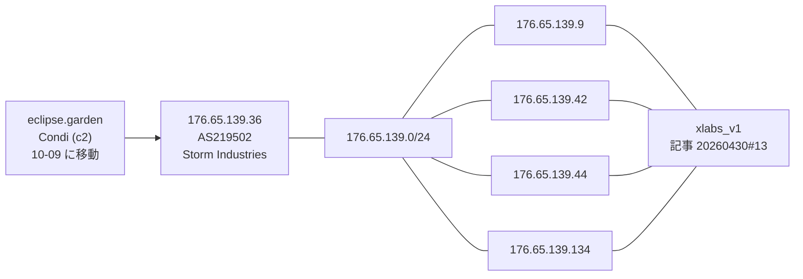
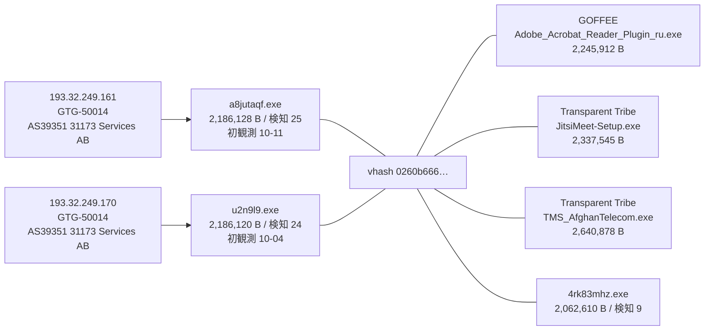
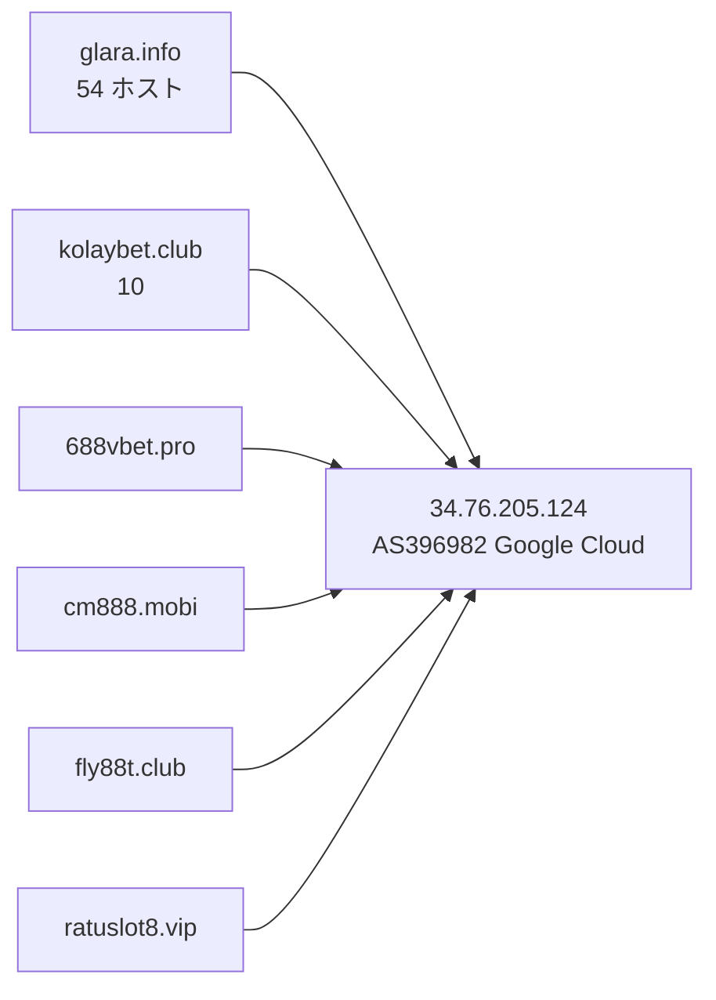

> **このレポートは AI（Claude）が自動生成したものです。人の確認を前提としてください。**

# 週次レポート 2026-W42（2026-10-10 〜 2026-10-17）

## 見つかったもの

### ドメインの生存と切り替わり

**今週のトラッカー（追跡 9,633 ドメイン、観測 7 日: 10-09〜10-17）は、役割つきでは薄い。**
変化 1,447 件のうち「行き先が変わった」は 1,355 件だが、役割つきで IPv4 が実際に
変わったのは、毎日組・事業者の印が付いたもの（S3・Vercel・Google・GitHub など）を除くと
5 ホスト（`eclipse.garden` `compute.in.net` `cnc.nomeum.net` `saicetyapy.space`
`www.iuqerfsodp9…wergwff.com`）だけ。最後の 1 つは毎日組の一族で「疑い」に回す。

**測定側の問題は直っていない。** 10-08 から解決器の AAAA と CNAME が消えたまま
で、10-09・10-12・10-17 の観測は 9,244 / 9,482 / 9,594 ホストのうち AAAA も CNAME
も 0 件。「別名の向き先が変わった」が 0 件なのはこのため（変化が無かったのではなく
見えていない）。**IPv6 と CNAME の変化は所見にしない。**

IPv4 の変化で見るべき役割つき 4 ホスト:

- **`compute.in.net`（`nanocore_configured_c2`）が 10-12 と 10-17 の 2 回動いた。**
  Cloudflare（`104.21.36.24` `172.67.184.51`、09-26 から）→ 10-12 に別の Cloudflare
  の組（`104.21.72.226` `172.67.187.210`）→ **10-17 に素の `162.255.119.211`
  （AS22612 Namecheap）**。`in.net` は動的 DNS の接尾辞として印が付いている
  （`track_domain` も偽）。移動先の IP は索引に無く、/24 も索引に無い
- **`eclipse.garden`（`c2`、Condi）は先週と同じ移動（10-09）が窓に残っているだけ。**
  Cloudflare（`104.21.0.212` `172.67.128.76`）→ `176.65.139.36`。以後は動いていない
  （「つながったもの」）
- **`saicetyapy.space`（`c2_or_network_ioc`）が 10-12 に nxdomain → alive、`3.250.92.156`
  に解決した。** 今週唯一の役割つきの復活（復活 18 件中 1 件。残り 17 件は役割なし）。
  AS は写しに無く未確認。IP は索引に無い
- `cnc.nomeum.net`（`C2/通信`）は 10-10・10-12 に IP の集合が入れ替わったが、先週と
  同じく Amazon のアドレス内で、移動ではない。`www.iuqerfsodp9…wergwff.com` の
  10-10 の移動は毎日組で、「疑い」に回す

**落ちたもの。** 74 件のうち役割つきは 4 件。`extecc.com.co`（`configured_c2`）が
10-17 に alive → no_answer、`www.extecc.com.co` が同日に alive → nxdomain（兄弟の記録は
無く、この 2 ホストだけの話）。`xevzora.cfd` が 10-15 に
alive → nxdomain（兄弟 1 / 1 件 `ve.xevzora.cfd` も nxdomain）。`thrillermotion.4nmn.com`
も 10-15 に落ちたが、`4nmn.com` は共用基盤なので所見にしない。先週の
`789betapps.com` は 15 / 15 件が引き続き nxdomain。

### 証明書の記録から出た兄弟

**今週は動いていない。** 追う価値のある兄弟は 256 → 256 件で、ホスト名の集合は
先週と同一（新規 0 / 消失 0）。共用基盤と判定された apex も先週と同じ 7 で、
新規は無い（`dropboxusercontent.com` `42web.io` `chickenkiller.com` `netcup.net`
`ydns.eu` `4nmn.com` `cpolar.top`）。256 件の今の状態は alive 181 / nxdomain 66 /
no_answer 9（先週 182 / 65 / 9）。

## つながったもの

### `176.65.139.36`（`eclipse.garden`）は、索引上の `xlabs_v1` の IP と同じ /24

索引の 5 IP のうち 4 つ（`.9` `.42` `.44` `.134`）は同じ記事（2026-04-30）で `xlabs_v1` に
帰属されている。残る `.31` は脆弱性の索引に出る IP で、マルウェアの帰属は無い。AS は
`176.65.139.0/24` が `/24` ちょうどで AS219502（Storm Industries LLC）に載っているので、
`.36` もそこと読める（妥当）。`eclipse.garden` は Condi で、マルウェアは違う。
**同じ /24 に居るという事実だけ**（妥当な事実、同一運用者かどうかは弱い）。

### 新しい検体 `a8jutaqf.exe` が、GOFFEE / Transparent Tribe と同じ vhash でアクター GTG-50014 の IP に出てきた

`193.32.249.161` 側の `a8jutaqf.exe`（10-11）が今週新しく拾えた検体で、`.170` 側の
2,186,120 B の検体は先週 `cqwae5cg0.exe` と書いたものと同じサイズ・初観測日
（VT 上の名前が取得ごとに違う）。`GOFFEE ↔ GTG-50014`・`GTG-50014 ↔ Transparent Tribe`
は索引上すでに結ばれている組で、新しい関係ではなく**補強**。`value_spread` は
6 IOC / 2 アクター。索引側の 4 検体は 2.06〜2.64 MB の 1.3 倍の幅、名前は偽インストーラ
（Adobe のプラグイン・Jitsi・通信事業者名）で揃っている。**汎用スタブの形ではない（妥当）。**
同じ検体は imphash `88016fcd…` でも 12 IOC / 4 アクターに広がるが、そちらは 10 検体が
2.06〜65.9 MB（32 倍）と桁が開いており却下（「疑い」の表）。

### `34.76.205.124`（Google Cloud）に、役割つき 6 apex が同居している

追跡 70 ホストが解決している（先週も 70）。`glara.info` の兄弟は 53 / 63 件がここ、
残りは no_answer 8・nxdomain 2。`kolaybet.club` の兄弟は 9 / 9 件がここ。
`glara.info` `kolaybet.club` `fly88t.club` は索引上いずれも AsyncRAT の別々の case に
属する。**IP は索引に無く、/24 も無い**（先週までと同じ足場）。賭博系の名前で揃って
おり、同一運用の可能性は妥当。このほか同じ IP に `viva.gr.com`、`zu7pl.pro`
（AnonyMousTeam）が居るが、`gr.com` は共有の接尾辞なので材料にしない。

## そこから得られそうなもの

- **`162.255.119.211`（`compute.in.net`）と `176.65.139.36`・`3.250.92.156`
  （`saicetyapy.space`）を次回の手動の的に加える（妥当）。** いずれも今週動いた役割つき
  ドメインの移動先・復活先で、IP は索引に無い。ただし `compute.in.net` は動的 DNS の
  印が付いており、`162.255.119.211` は Namecheap の共用帯なので、入口としては弱い
- **`193.32.249.161` の検体 `a8jutaqf.exe`（初観測 10-11、検知 25）。** 索引に無い新しい
  検体で、vhash `0260b666…` を軸に同族を追える（妥当）。vhash の検体は索引側 4 + 今週
  の 2 で小さく、網羅はできていない
- **兄弟が固まっている IP に、新しい足場は今週は無い。** 256 件のうち IP に
  解決した 181 件の上位は `34.76.205.124`（62）・`103.224.182.216`（59、毎日組
  `iuqerfsodp9…`）・`185.53.179.200`（18、同）・`208.91.197.39`（12、`szpd.info`、
  AS40034）・`34.41.139.193`（9、`websencl.com`）・`146.70.81.56`（8、`asecdns.com`、
  AS9009）で、いずれも先週と同じ。`146.70.81.56` の /24 は索引にあり
  （`146.70.81.218`、Candiru）、先週までに報告済み
- **生存ドメインに付いた索引外の検体は 10 ドメイン。** 役割つきは
  `dl.dropboxusercontent.com`（`dead_drop_configuration`）と
  `www.iuqerfsodp9…wergwff.com`（`C2/通信`）の 2 つで、どちらも 120 件の上限に
  達していて、共用基盤・毎日組なので入口としては弱い。残りは役割なしで、
  `3w.jxuw3.com`（42 件、毎日組）が量の多いほう。単独では追う理由にならない

## 疑い

**`black-popular.com` `us.lenovoappstore.com` `connect-microsoft.com`
`samsungcdn.com` の 4 件が今週も `153.236.181.151` に同居している（4 / 4 件）が、
先週取り下げたとおり、4 つの別アクターが同じ基盤を使っていた証拠とは読まない。**
先週は `*.sinkhole.yourtrap.com` への CNAME で確認したが、今週は CNAME が測定できない
ため再確認できていない（上の測定側の問題）。**この 4 件を 1 つの基盤とも、3 アクター
の共有とも読まない。**

**`34.41.139.193`（Google Cloud）に、追跡 77 ホスト・55 apex が居て、索引は
そのうち 15 アクターに帰属している**（Lazarus・APT28・Ghostwriter・Anonymous・
UNC5174 など。先週 80 ホストから 3 減）。別々のアクターのドメインがこれだけ 1 つの
IP に集まるのは、運用基盤の共有というより、**失効・押収したドメインの受け皿
（シンクホールや駐車）と読むほうが自然（仮説）**。`websencl.com`（9 兄弟、9 / 9 件が
ここ）はこの中の 1 つで、ここから他アクターとの関係は引けない。

**今週のピボット**は、的 150（IP 120 / ドメイン 30）、写し 300 件、索引に無い検体
2,156 件を回収し、生の橋 47 組のうち 29 組がガードで落ち、18 組が通った
（既知 5 / 新規 13）。通った組は 1 組を除いて先週と同じ顔ぶれ。

| 組 | 値 | value_spread | 今週確認した中身 | 判断 |
| --- | --- | --- | --- | --- |
| GTG-50014 ↔ Transparent Tribe / GOFFEE | vhash `0260b666…` | 6 IOC / 2 アクター | 2.06〜2.64 MB（索引側 4 検体）＋今週の 2.19 MB の 2 検体・偽インストーラ（「つながったもの」） | 妥当（既知の関係の補強） |
| GTG-50014 ↔ PhantomEnigma / Rognar | imphash `88016fcd…` | 12 IOC / 4 アクター | 10 検体が 2.06〜65.9 MB（32 倍）、名前は 1 検体ごとに違う（`JitsiMeet-Setup.exe` `MicroUpdaterV1.exe` `0a3dqJMhiA__` など） | 却下（汎用スタブ） |
| Chatty Spider ↔ X3D MINER | imphash `1aae8bf5…` | 9 IOC / 2 アクター | 索引側 8 検体が 1.76〜3.89 MB（2.2 倍）、検知 50 台、名前は sha256 名・乱数・`ftuarit` | 妥当（先週から継続、今週新たな根拠は無い） |
| Chatty Spider ↔ The Gentlemen | imphash `1aae8bf5…` | 9 IOC / 2 アクター | 同上（同一 imphash） | 妥当（同上） |
| SMOKE#SCREEN ↔ Storm-2949 | vhash `05605665…` | 3 IOC / 1 アクター | `ScreenConnect.ClientSetup.exe` 5,873,112 B（実在 RMM） | 却下維持 |
| Storm-2949 ↔ The Gentlemen | imphash `c2d457ad…` | 3 IOC / 2 アクター | `tor-relay-scanner-go-windows-amd64.exe`（実在 OSS）、2 検体が 1.9〜18.2 MB（9.3 倍） | 却下維持 |
| Golden Chickens ↔ KongTuke / Qilin / TAG-195 | vhash `c0898bab…` | 5 IOC / 1 アクター | `update.msi` 1,298,432 B と `Ca.msi` 48,128 B（27 倍）、今週の 2 検体は乱数名の 49,152 B | 却下維持（サイズが 27 倍開く） |
| APT37 ↔ Chatty Spider / Myxa VPN | imphash `948cc502…` | 4 IOC / 1 アクター | 名前は複数ファミリのラベルを連結した検体フィード名、915,968〜1,212,416 B | 却下維持 |
| Chatty Spider ↔ GreyVibe | imphash `f4639a0b…` | 4 IOC / 1 アクター | 今週の検体 `1qIh0OG9LBRng37HofIABjHl.exe` は 820,171 B、索引側 3 検体は 16.7〜17.5 MB（約 21 倍） | 却下 |
| Myxa VPN ↔ masterblack / Gambling Goblin | vhash `e840a106…` | 7 IOC / 2 アクター | 索引側 6 検体が 5.75〜76.3 MB（13 倍）・ELF の汎用ツール（`rclone` `esxi` `gowitness-3.1.1-linux-amd64`） | 却下維持 |
| FortiBleed ↔ UNK_DeadDrop | vhash `77ac44bd…` | 3 IOC / 1 アクター | 3 検体、6.44〜14.66 MB（2.3 倍）、ELF、名前は乱数・sha1 名・`multipathd_04d0`。今週の検体は検知 6 | 材料不足で判断保留 |
| **Exvicy ↔ UAT-6275**（新規） | vhash `4ff2a788…` | 8 IOC / 1 アクター | 今週の 5 検体は 260〜273 B の PowerShell で、検知は 5 検体中 4 が 0（残る 1 つが 5）。索引側 3 検体も 1.1〜1.6 KB の PowerShell。`update.ps1` `sleestak_payload_1.ps1` と乱数名。UAT-6275 側の検体は検知 16 | 弱い（却下寄り）。数百 B の小さなスクリプトでは vhash が形しか見ておらず、同じ形の別物が衝突しうる。名前 `sleestak_payload_1.ps1` が Exvicy の 2 IP（`89.34.90.217` `65.21.208.199`）で共通なのは Exvicy 内の結び付きで、UAT-6275 への根拠にはならない |

先週あった `Myxa VPN ↔ TA4922` と `APT29 sub-cluster / GTG-20006 / Rognar ↔ UNC6240` は
今週も出なかった。**的が変わったための欠落で、関係が消えたとは読まない。**

**`iuqerfsodp9…wergwff.com`（WannaCry killswitch のシンクホール、毎日組）は、
`www.` が 10-10 に `216.245.197.41` から `103.224.182.216` へ移ったまま。**
追跡 60 ホストが `103.224.182.216`（兄弟 59）、18 ホストが `185.53.179.200` に解決している。
どちらも索引に IP としては無い。毎日組なので所見にはしない。

**「毎日組」は 177 件**（観測 7 日のうち 4 日以上動いたもの、追跡 9,633 件中。先週は
228 件）。先頭 20 件は `iuqerfsodp9…` の子と、Google・Microsoft・Vercel・S3 といった
事業者の名前の入れ替わりで、先週と同じ性質。役割つきで毎日組の印が付いた移動
（`xjsjkjdsjjd.s3.ap-southeast-1.amazonaws.com`、`cleverstack-ext30341.vercel.app`、
`drive.google.com`、`gist.github.com`）は、行き先が毎日入れ替わる構成で、所見にしない。
