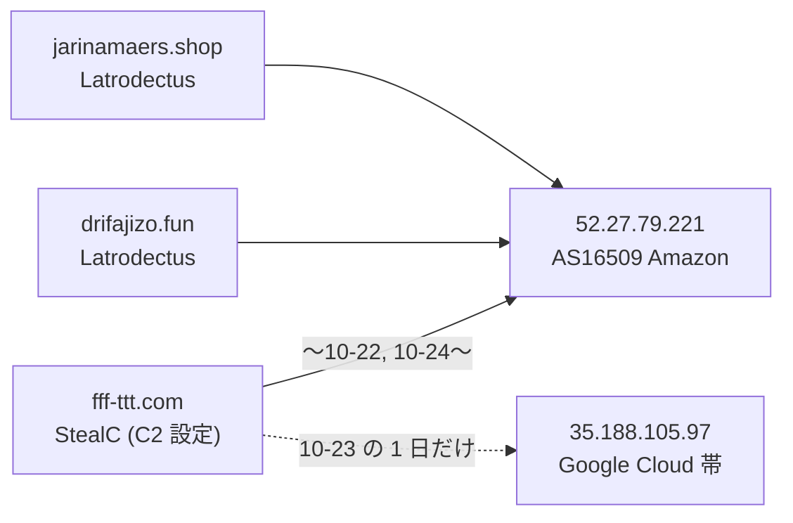
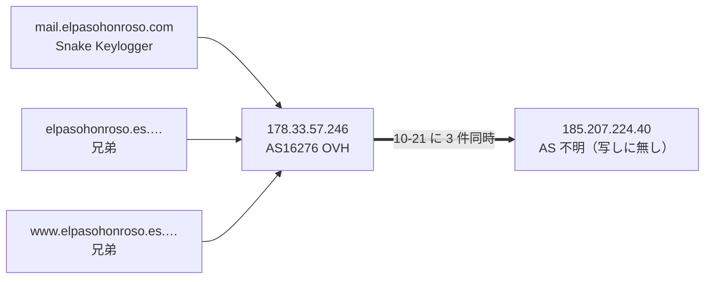
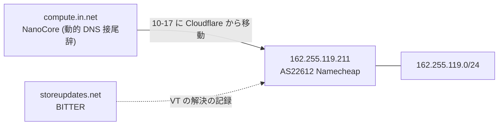
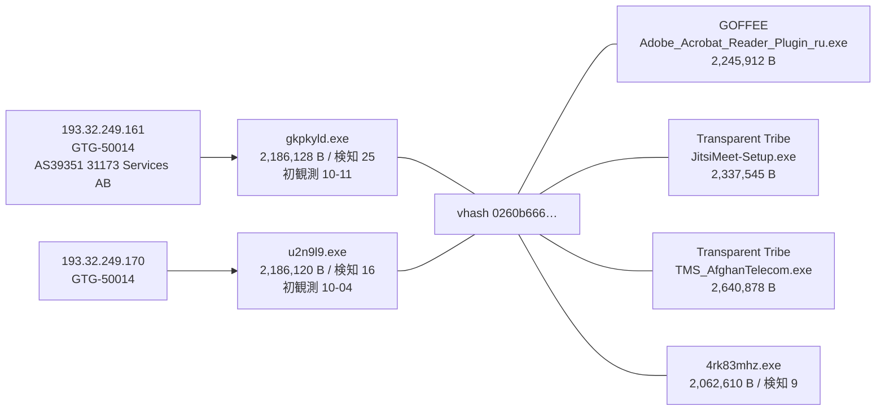
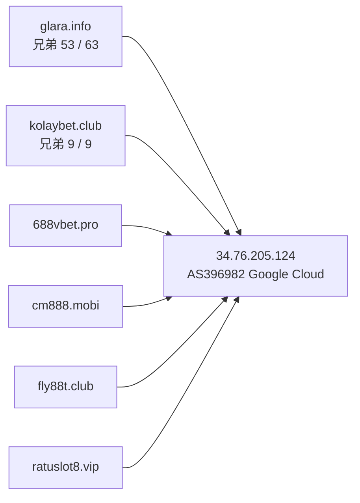

> **このレポートは AI（Claude）が自動生成したものです。人の確認を前提としてください。**

# 週次レポート 2026-W43（2026-10-18 〜 2026-10-24）

## 見つかったもの

### ドメインの生存と切り替わり

**今週のトラッカー（追跡 9,664 ドメイン、観測 7 日: 10-18〜10-24）は、役割つきでは薄い。**
変化 1,237 件のうち「行き先が変わった」は 1,179 件だが、毎日組・事業者の印が付いたもの
（S3・Vercel・Google・GitHub・Microsoft・Steam）を除くと、役割つきで IPv4 が動いたのは
5 ホストだけ（`fff-ttt.com` `alpharush.ai` `cnc.nomeum.net` `mail.elpasohonroso.com`、
共用基盤の `dl.dropboxusercontent.com`）。復活 17 件・落ちた 41 件は、**役割つきが
どちらも 0 件**（17 / 17、41 / 41 が役割なし）。

**測定側の問題は直っていない。** 先週と同じく解決器の AAAA と CNAME が取れておらず、
「別名の向き先が変わった」は 0 件。変化が無かったのではなく見えていない。
**IPv6 と CNAME の変化は所見にしない。** 判定保留は 211 / 9,664 件（2.2%）で、
5% の線は超えていない。

役割つき 4 ホストの動き（IPv4 のみ）:

- **`mail.elpasohonroso.com`（`credential_exfiltration`、Snake Keylogger）が 10-21 に
  `178.33.57.246`（AS16276）から `185.207.224.40` へ移った。** 同じ日に、同じ apex の
  兄弟 2 件（`elpasohonroso.es.elpasohonroso.com` と `www.` 付き）も同じ IP へ移った
  （3 / 3 件が一緒に動いた）。以後は動いていない。移動先は索引に無い（「つながったもの」）
- **`fff-ttt.com`（StealC の C2 設定）が 10-23 に `52.27.79.221`（AWS）→
  `35.188.105.97`、10-24 に `52.27.79.221` へ戻った。** 2 日だけの往復で、今は元の IP
  （「つながったもの」）
- **`alpharush.ai`（`nanocore_configured_controller`）が 10-23 に Cloudflare の組を
  `104.21.59.117` `172.67.177.48` → `104.21.49.62` `172.67.142.78` に入れ替えた。**
  Cloudflare の中での入れ替わりで、移動ではない。09-26 以降 2 回目
- **`cnc.nomeum.net`（`C2/通信`）は 10-23 に IP の集合が入れ替わった**（今は 6 IP、
  追跡開始から 23 回）。先週と同じく Amazon のアドレス内の入れ替わりで、移動ではない。
  集合に `100.61.160.238` が入ったが、これだけ Amazon の帯ではなく、素性は未確認

**落ちた・生き返ったもの。** 役割つきは無い。先週落ちた `extecc.com.co`（`configured_c2`）は
no_answer のまま、`xevzora.cfd` は nxdomain のまま、`789betapps.com` も nxdomain のまま。
先週取り上げた `eclipse.garden`（Condi、`176.65.139.36`）と `saicetyapy.space`
（`3.250.92.156`）、`compute.in.net`（`162.255.119.211`）は今週は動いていない。

### 証明書の記録から出た兄弟

**今週は動いていない。新しい兄弟は 0 件。** 今回の取得は 108 apex のうち 100 apex で
打ち切られた（レート制限 HTTP 429）。読めた 100 apex から残った兄弟は 219 件で、
そのうち先週のホスト名と違うものは 0 / 219 件。先週の 256 件との差の 37 件は
消えたのではなく、読めなかった apex（`xlit.top` 7・`szpd.info` 12・`s666hn.com` 8・
`websencl.com` 9・`xevzora.cfd` 1）の分で、**消失とは読まない**。

共用基盤と判定された apex は 6 で、**すべて先週の 7 に含まれる（新規は無い）**。
`dropboxusercontent.com`（148,334）`42web.io`（46,622）`chickenkiller.com`（40,451）
`netcup.net`（31,632）`4nmn.com`（8,488）`cpolar.top`（563）。先週あった `ydns.eu` は
打ち切りで読めていない。219 件の今の状態は alive 160 / nxdomain 50 / no_answer 9。

## つながったもの

### `52.27.79.221`（AWS）に、StealC の `fff-ttt.com` と Latrodectus の 2 ドメインが同居している

追跡ホスト 3 / 3 件が `52.27.79.221` に解決している（`fff-ttt.com` `drifajizo.fun`
`jarinamaers.shop`）。IP は索引上、この 3 ドメインの DNS として載っている。
**同じ IP に別ファミリ（StealC と Latrodectus）の C2 が同居しているという事実だけ**
（妥当な事実）。AWS の 1 台を複数人が使うことは珍しくないので、同一運用とは読まない
（弱い）。`35.188.105.97` は索引に無く、AS は写しに無い（Google Cloud の帯に見えるが
未確認）。

### `185.207.224.40` に、`elpasohonroso.com` の 3 ホストが 10-21 に一緒に移った

3 / 3 件が同じ日に同じ IP へ移った。証明書の記録から出た兄弟が、本体と運用を共にして
いる裏付け（妥当）。移動先の `185.207.224.40` は索引に無く、/24 も索引に無い
（AS は写しに無い）。

### `compute.in.net`（NanoCore）の移動先 `162.255.119.211` は、索引上 BITTER の `storeupdates.net` の解決先でもある

先週は「IP は索引に無い」と書いたが、**訂正する。** この IP は索引に VT の解決の記録として
あり、`storeupdates.net`（BITTER、今は no_answer）が過去に向いていた。ただし
Namecheap の共用帯の 1 つで、`compute.in.net` も動的 DNS の接尾辞なので、
**同一運用の根拠にはならない（弱い）。** 同じ IP を過去に使ったという事実だけ。

### 新しい検体 `gkpkyld.exe` が、GOFFEE / Transparent Tribe と同じ vhash でアクター GTG-50014 の IP に出ている

先週 `a8jutaqf.exe` と書いた 2,186,128 B・初観測 10-11 の検体は、今週の取得では
`gkpkyld.exe` という名前で返っている（VT 上の名前が取得ごとに違うだけで、同じ検体と
読む）。`GOFFEE ↔ GTG-50014`・`GTG-50014 ↔ Transparent Tribe` は索引上すでに結ばれた組で、
新しい関係ではなく**補強**。`value_spread` は 6 IOC / 2 アクター。索引側 4 検体は
2.06〜2.64 MB の 1.3 倍の幅で、名前は偽インストーラ（Adobe のプラグイン・Jitsi・
通信事業者名）で揃っている。**汎用スタブの形ではない（妥当）。**

### `34.76.205.124`（Google Cloud）に、役割つき 6 apex が同居している

追跡 70 ホストが解決している（先週も 70）。`glara.info` の兄弟は 53 / 63 件がここ
（残りは no_answer 8・nxdomain 2）、`kolaybet.club` の兄弟は 9 / 9 件がここ。
**IP は索引に無く、/24 も無い**（先週までと同じ足場）。賭博系の名前で揃っており、
同一運用の可能性は妥当。同じ IP に `gr.com`・`zu7pl.pro` の子も居るが、`gr.com` は
共有の接尾辞なので材料にしない。

## そこから得られそうなもの

- **`185.207.224.40`（`elpasohonroso.com` の 3 ホストの移動先）と `35.188.105.97`
  （`fff-ttt.com` が 1 日だけ向いた先）を次回の手動の的に加える（妥当）。** どちらも索引に
  無い。`185.207.224.40` は Snake Keylogger の資格情報送出先に使われていた
  メールホストの現在地で、同居するほかの apex が見つかれば運用の広がりが引ける。
  `35.188.105.97` は 1 日だけなので入口としては弱い
- **先週の `3.250.92.156`（`saicetyapy.space`）は、今週も索引に無い。** 動きは無かった
- **兄弟が固まっている IP に、新しい足場は今週は無い。** 219 件の上位は
  `34.76.205.124`（62）・`103.224.182.216`（59、毎日組 `iuqerfsodp9…`）・
  `185.53.179.200`（18、同）・`146.70.81.56`（8、`asecdns.com`）で、先週と同じ。
  `185.207.224.40`（2、`elpasohonroso.com`）が新しく 2 件以上固まった IP だが、
  上のとおり移動先で、兄弟が新しく増えたわけではない
- **`gkpkyld.exe`（初観測 10-11、検知 25）の vhash `0260b666…`。** 索引側 4 検体と今週の 2 検体
  で小さく、網羅はできていない。同族を追う入口にはなる（妥当）
- **生存ドメインに付いた索引外の検体は 11 ドメイン。** 役割つきは
  `dl.dropboxusercontent.com`（`dead_drop_configuration`）と
  `www.iuqerfsodp9…wergwff.com`（`C2/通信`）の 2 つで、どちらも 120 件の上限に達していて、
  共用基盤・毎日組なので入口としては弱い。残りは役割なしで、単独では追う理由にならない

## 疑い

**`black-popular.com` `us.lenovoappstore.com` `connect-microsoft.com` `samsungcdn.com` の
4 件は、今週も同じ IP に同居している（4 / 4 件が `153.248.52.134`）。** 先週は
`153.236.181.151` で、この 1 週間にここへ入れ替わった（`black-popular.com` は追跡開始から
IP 変化 7 回）。4 つの別アクターのドメインが、同じ IP へ揃って動き続けるのは、
運用の共有というより**シンクホールの受け皿の動きと読むほうが自然（仮説）**。
先週は CNAME（`*.sinkhole.yourtrap.com`）で確認したが、CNAME が測定できないため
今週は再確認できていない。**この 4 件を 1 つの基盤とも、アクターの共有とも読まない。**

**`34.41.139.193`（Google Cloud）に、追跡 80 ホストが居る**（先週 77 から 3 増）。
先週は 55 apex・索引上 15 アクターに帰属すると書いた（Lazarus・APT28・Ghostwriter・
Anonymous・UNC5174 など）。別々のアクターのドメインがこれだけ 1 つの IP に集まるのは、
運用基盤の共有というより、失効・押収したドメインの受け皿（シンクホールや駐車）と
読むほうが自然（仮説）。apex 数・アクター数は今週は引き直していない。

**今週のピボット**は、的 150（IP 120 / ドメイン 30）、写し 300 件、索引に無い検体 2,131 件を
回収し、橋 48 組のうち 30 組がガードで落ち、18 組が通った（既知 5 / 新規 13）。
**通った 18 組は先週と同じ顔ぶれで、新しい橋は 0 件。**

| 組 | 値 | value_spread | 今週確認した中身 | 判断 |
| --- | --- | --- | --- | --- |
| GTG-50014 ↔ Transparent Tribe / GOFFEE | vhash `0260b666…` | 6 IOC / 2 アクター | 2.06〜2.64 MB（索引側 4 検体）＋今週の 2.19 MB の 2 検体・偽インストーラ（「つながったもの」） | 妥当（既知の関係の補強） |
| GTG-50014 ↔ PhantomEnigma / Rognar | imphash `88016fcd…` | 12 IOC / 4 アクター | 索引側 9 検体が 2.06〜65.9 MB（32 倍）、名前は 1 検体ごとに違う（`AFTEL_VPN_Setup.exe` `MicroUpdaterV1.exe` `0a3dqJMhiA__` など） | 却下（汎用スタブ） |
| Chatty Spider ↔ X3D MINER / The Gentlemen | imphash `1aae8bf5…` | 9 IOC / 2 アクター | 索引側 8 検体が 1.76〜3.89 MB（2.2 倍）、検知 42〜55、名前は sha256 名・乱数・`Ableton Live 12 Suite License.exe`。拾った検体も 2.47 MB・検知 50 | 妥当（先週から継続、今週新たな根拠は無い） |
| SMOKE#SCREEN ↔ Storm-2949 | vhash `05605665…` | 3 IOC / 1 アクター | 索引側 2 検体が 5.66〜5.69 MB、拾った検体は `ScreenConnect.ClientSetup.exe` 5,873,112 B（実在の RMM） | 却下維持 |
| Storm-2949 ↔ The Gentlemen | imphash `c2d457ad…` | 3 IOC / 2 アクター | `tor-relay-scanner-go-windows-amd64.exe`（実在 OSS）、索引側 2 検体が 1.9〜18.2 MB（9.3 倍） | 却下維持 |
| Golden Chickens ↔ KongTuke / Qilin / TAG-195 | vhash `c0898bab…` | 5 IOC / 1 アクター | 索引側 `update.msi` 1,298,432 B と `Ca.msi` 48,128 B（27 倍）、拾った 2 検体は乱数名の 49,152 B | 却下維持（サイズが 27 倍開く） |
| APT37 ↔ Chatty Spider / Myxa VPN | imphash `948cc502…` | 4 IOC / 1 アクター | 名前は複数ファミリのラベルを連結した検体フィード名、915,968〜1,212,416 B | 却下維持 |
| Chatty Spider ↔ GreyVibe | imphash `f4639a0b…` | 4 IOC / 1 アクター | 拾った検体は 820,171 B、索引側 3 検体は 16.7〜17.5 MB（約 21 倍） | 却下 |
| Myxa VPN ↔ masterblack / Gambling Goblin | vhash `e840a106…` | 7 IOC / 2 アクター | 索引側 4 検体が 5.75〜48.7 MB、ELF と EXE が混じり、`gowitness-3.1.1-linux-amd64`（実在ツール）を含む | 却下維持 |
| FortiBleed ↔ UNK_DeadDrop | vhash `77ac44bd…` | 3 IOC / 1 アクター | 3 検体、6.44〜14.66 MB（2.3 倍）、ELF、名前は乱数・sha256 名・`multipathd_04d0` | 材料不足で判断保留 |
| Exvicy ↔ UAT-6275 | vhash `4ff2a788…` | 8 IOC / 1 アクター | 拾った 5 検体は 260〜273 B の PowerShell で、検知は 4 / 5 が 0。索引側 3 検体も 1.1〜1.6 KB の PowerShell | 弱い（却下寄り）。数百 B のスクリプトでは vhash が形しか見ておらず、同じ形の別物が衝突しうる |

**毎日組は 156 件**（観測 7 日のうち 4 日以上動いたもの、追跡 9,664 件中。先週は 176 件）。
役割つきで毎日組の印が付いたものは 6 件（`xjsjkjdsjjd.s3.ap-southeast-1.amazonaws.com`
`cleverstack-ext30341.vercel.app` `drive.google.com` `gist.github.com` `microsoft.com`
`steamcommunity.com`）で、行き先が毎日入れ替わる事業者・配信基盤の構成。**所見にしない。**
そのほかは `iuqerfsodp9…` の子（WannaCry の killswitch のシンクホール、`103.224.182.216` に
60 ホスト）と、事業者の名前の入れ替わりで、先週と同じ性質。
