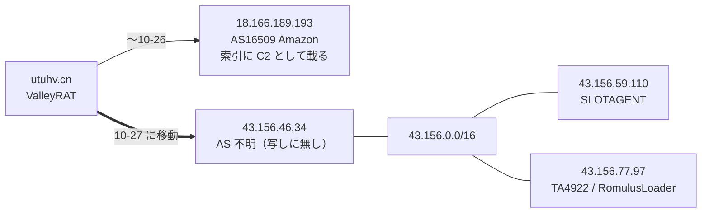
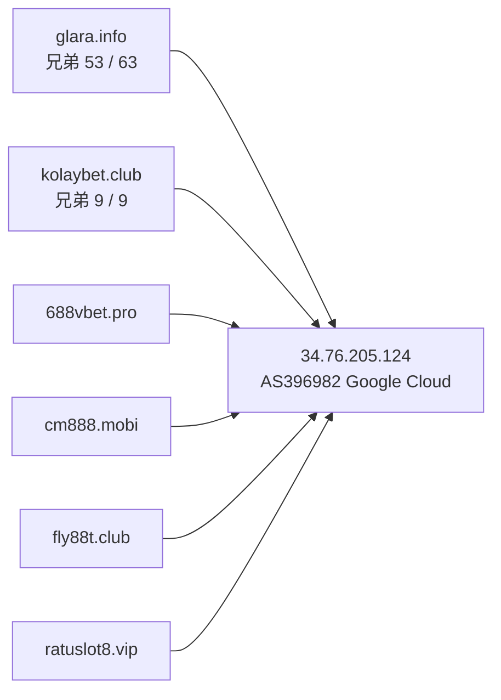
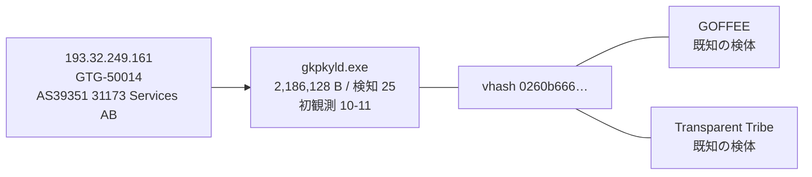

> **このレポートは AI（Claude）が自動生成したものです。人の確認を前提としてください。**

# 週次レポート 2026-W44（2026-10-25 〜 2026-10-31）

## 見つかったもの

### ドメインの生存と切り替わり

**今週のトラッカー（追跡 9,802 ドメイン、観測 7 日: 10-25〜10-31）は、役割つきでは薄い。**
道具の出力は 10-24 を含み、変化 1,326 件・「行き先が変わった」1,174 件。10-24 の分は先週
載せたので除く。毎日組・事業者の印が付いたもの（S3・Vercel・Google・Microsoft・Steam・
OneDrive）を除くと、役割つきで IPv4 が動いたのは `cnc.nomeum.net` と `utuhv.cn` の 2 ホスト。

**測定側の問題は直っていない。** 解決器の AAAA と CNAME が取れておらず（観測行の
`aaaa` `cname` `ns` が ENODATA。CNAME の変化の記録は 10-08 が最後）、「別名の向き先が
変わった」は 0 件。変化が無かったのではなく見えていない。**IPv6 と CNAME の変化は所見に
しない。** 判定保留は 226 / 9,802 件（2.3%）で、5% の線は超えていない。

- **`utuhv.cn`（ValleyRAT、`c2_candidate_static_config`）が 10-27 に `18.166.189.193`
  （AS16509 Amazon）から `43.156.46.34` へ移った。** 移動前の IP は索引に C2 として載っている
  （`c2_resolution_observed`）。1 日だけの往復ではなく、以後は動いていない（「つながったもの」）。
  トラッカーは `事業者` の印を付けているが、その理由までは確認していない。
  印の有無に関わらず、IP が別の帯へ替わった事実は変わらない
- **`cnc.nomeum.net`（`C2/通信`）は 10-25 と 10-27 の 2 回、IP の集合が入れ替わった**
  （追跡開始から 25 回）。先週までと同じく Amazon のアドレス内の入れ替わりで、移動ではない。
  `100.61.160.238`（Amazon の帯ではない）は今週も集合に居続けている
- **`instance-hhwlfk-relay.screenconnect.com`（`remote_management_relay`、ScreenConnect RMM）が
  10-28 に nxdomain → alive へ生き返った。** 8 月〜9 月に parkinglot へ CNAME が出入りした末、
  9-18 に nxdomain になっていたもの。生き返りは落ちたものより珍しいので記録するが、
  ScreenConnect のクラウドの中継名で `事業者` の印が付いている。IP は 10-28 に
  `107.21.151.217` 等 3 つ、10-29 に `3.209.159.70` 等 3 つへ（いずれも Amazon の帯）。
  **誰が再開したかは名前から分からない（弱い）**

**落ちたもの。** 役割つきは 5 件（落ちた 134 件のうち）。`ftp.hivimer.com`（Agent Tesla、
`c2_or_network_ioc`）と `ftp.vilimorin.com`（Agent Tesla、`credential_exfiltration`）が
10-27 に nxdomain、`www.iuqerfsodp9…`（WannaCry の killswitch 一族、`C2/通信`）が同日 nxdomain、
`amm-frosty.lol`（`C2/通信`、Cloudflare の背後）が 10-29 に nxdomain、`rororo2323.bounceme.net`
（AsyncRAT、`configured_c2`、動的 DNS）が 10-25 に no_answer。**Agent Tesla の ftp 受け口が
2 件同じ日に落ちた**が、apex は別（`hivimer.com` `vilimorin.com`）で、同じ日に消えた理由は
名前から分からない（仮説: 同じ事業者による一括停止。未確認）。
生き返った 18 件のうち役割つきは上の ScreenConnect の 1 件だけで、残りは役割なし。

先週取り上げた `eclipse.garden`（`176.65.139.36`）・`saicetyapy.space`（`3.250.92.156`）・
`compute.in.net`（`162.255.119.211`）・`fff-ttt.com`（`52.27.79.221`）・
`mail.elpasohonroso.com`（`185.207.224.40`）・`alpharush.ai` は今週は動いていない。

### 証明書の記録から出た兄弟

**今週はほぼ動いていない。新しい兄弟は 2 件。** 役割つき apex は 139 になったが、今回の取得は
**100 / 139 apex で打ち切られた（レート制限 HTTP 429）**。読めた 100 apex から残った兄弟は
221 件（先週 219 件）で、先週のホスト名と違うのは 2 / 221 件（`sla.magsa.com.pe`
`www.sla.magsa.com.pe`）。読めなかった 39 apex の分は**消失とは読まない**。

共用基盤と判定された apex は 6 で、**すべて先週の 6 に含まれる（新規は無い）**。
`dropboxusercontent.com`（148,334）`42web.io`（46,626）`chickenkiller.com`（40,918）
`netcup.net`（31,697）`4nmn.com`（8,488）`cpolar.top`（563）。

221 件の今の状態は、追跡側で引き直すと nxdomain が多い（`iuqerfsodp9…` の 79 件は 79 / 79
が nxdomain、`789betapps.com` の 15 件は 15 / 15 が nxdomain）。alive は `glara.info`
53 / 63・`kolaybet.club` 9 / 9・`asecdns.com` 8 / 8・`magsa.com.pe` 4 / 6 など。

## つながったもの

### `utuhv.cn`（ValleyRAT）の移動先 `43.156.46.34` は、索引上の別アクターの C2 と同じ /16 にある

移動先の IP も /24（`43.156.46.0/24`）も索引に無い。同じ /16 には、別の記事から出た C2 の
IP が 2 件ある（SLOTAGENT 2026-04-30・TA4922 の RomulusLoader 2026-06-05）。ただし /24 が違い、
/16 は大きすぎる帯なので、**関係の根拠にはならない（弱い）**。「同じ帯に別の C2 が居る」
事実だけ。AS は写しに無く、この帯の持ち主は未確認。

### `34.76.205.124`（AS396982 Google Cloud）に、役割つき 6 apex が同居している（継続）

追跡 70 ホストが解決している（先週も 70）。`glara.info` の兄弟は 53 / 63 件がここ、
`kolaybet.club` の兄弟は 9 / 9 件がここ。**IP は索引に無く、/24 も無い**（先週までと同じ足場）。
賭博系の名前で揃っており、同一運用の可能性は妥当。同じ IP に `viva.gr.com`・`zu7pl.pro` の
ホストも居るが、`gr.com` は共有の接尾辞なので材料にしない。

### 新しい検体 `gkpkyld.exe` が、GOFFEE / Transparent Tribe と同じ vhash でアクター GTG-50014 の IP に出ている（継続・新しい根拠は無し）

橋 18 組の顔ぶれは**先週と同じ。新しい橋は 0 件**（写し 300 件・索引に無い検体 2,180 件・
的 150 = IP 120 / ドメイン 30 から、橋 48 組のうちガードを通ったのが 18 組、既知 5 / 新規 13、
落ちた 30 組）。`GOFFEE ↔ GTG-50014` と `GTG-50014 ↔ Transparent Tribe` は索引上すでに結ばれた
組で、補強。`value_spread` は 6 IOC / 2 アクター。汎用スタブの形ではない（妥当）。

## そこから得られそうなもの

- **`43.156.46.34`（`utuhv.cn` の移動先）を次回の手動の的に加える（妥当）。** 索引に無い。
  同居するほかの apex が見つかれば、ValleyRAT の運用の広がりが引ける。1 回の移動なので入口としては
  中程度
- **`saicetyapy.space`（Latrodectus）に付いた索引外の検体 15 件。** 先週から「生存ドメインに
  付いた索引外の検体」の入口に挙がっていた。`Letter_*.js` 5 件（vhash `effba3c4…` が 4 件）と
  `sophtlib.dll` 2 件（vhash `116076655d…`、検知 46〜49）・`Model.dll`・`gsm.msi` など。
  初観測は**すべて 2024-02**で、ドメインは 10-12 に生き返ったばかり。20 か月前の検体で、
  今の運用との関係は**弱い（仮説）**。vhash `effba3c4…` と `116076655d…` は同族を引く入口にはなる
- **生存ドメインに付いた索引外の検体は 28 ドメイン**（先週 11）。役割つきは
  `dl.dropboxusercontent.com`（120 件の上限に達した共用基盤）・`saicetyapy.space`・
  `zjcounty.com`（`payload_distribution`、1 件、2026-07-19、検知 8、PowerShell）の 3 つ。
  残りは役割なしで、単独では追う理由にならない。役割なしが 25 / 28 で、
  増えたこと自体は所見にしない
- **兄弟が固まっている IP に、新しい足場は今週は無い。** 上位は先週と同じ
  `34.76.205.124`・`146.70.81.56`（8、`asecdns.com`）・`192.185.37.239`（4、`magsa.com.pe`）・
  `217.144.107.127`（2、`4bagh.net`）・`103.224.93.246`（2、`cyberflor.co`）・
  `185.207.224.40`（2、`elpasohonroso.com`）。`iuqerfsodp9…` の 79 件は全て nxdomain になり、
  固まる IP すら無い

## 疑い

**`black-popular.com` `us.lenovoappstore.com` `connect-microsoft.com` `samsungcdn.com` の
4 件は、今週も同じ IP に同居している（4 / 4 件が `153.248.52.134`）。** 先週と同じ IP で、
別アクター 4 つのドメインが 1 つの IP に揃っているのは、運用の共有というより
**シンクホールの受け皿と読むほうが自然（仮説）**。CNAME が測定できないため再確認はできていない。
**この 4 件を 1 つの基盤とも、アクターの共有とも読まない。**

**`34.41.139.193`（Google Cloud）に、追跡 80 ホストが居る**（先週と同じ 80）。別々のアクターの
ドメインがこれだけ集まるのは、失効・押収したドメインの受け皿（シンクホールや駐車）と
読むほうが自然（仮説）。apex 数・アクター数は今週は引き直していない。

**橋 18 組の検分（先週から顔ぶれ・値とも同じ。変わったのは FortiBleed ↔ UNK_DeadDrop の
拾った検体の検知が 6 → 11 になった点のみ）。**

| 組 | 値 | value_spread | 判断 |
| --- | --- | --- | --- |
| GTG-50014 ↔ Transparent Tribe / GOFFEE | vhash `0260b666…` | 6 IOC / 2 アクター | 妥当（既知の関係の補強。`gkpkyld.exe` 2,186,128 B を今週の写しで再確認） |
| GTG-50014 ↔ PhantomEnigma / Rognar | imphash `88016fcd…` | 12 IOC / 4 アクター | 却下（汎用スタブ。先週確認した 32 倍のサイズ幅と 1 検体ごとに違う名前） |
| Chatty Spider ↔ X3D MINER / The Gentlemen | imphash `1aae8bf5…` | 9 IOC / 2 アクター | 妥当（先週から継続、今週新たな根拠は無い） |
| SMOKE#SCREEN ↔ Storm-2949 | vhash `05605665…` | 3 IOC / 1 アクター | 却下維持（拾った検体は実在の RMM の `ScreenConnect.ClientSetup.exe`） |
| Storm-2949 ↔ The Gentlemen | imphash `c2d457ad…` | 3 IOC / 2 アクター | 却下維持（実在 OSS の検体） |
| Golden Chickens ↔ KongTuke / Qilin / TAG-195 | vhash `c0898bab…` | 5 IOC / 1 アクター | 却下維持（サイズが 27 倍開く） |
| APT37 ↔ Chatty Spider / Myxa VPN | imphash `948cc502…` | 4 IOC / 1 アクター | 却下維持（検体フィード名） |
| Chatty Spider ↔ GreyVibe | imphash `f4639a0b…` | 4 IOC / 1 アクター | 却下（約 21 倍のサイズ幅） |
| Myxa VPN ↔ masterblack / Gambling Goblin | vhash `e840a106…` | 7 IOC / 2 アクター | 却下維持（ELF と EXE の混在・実在ツール） |
| FortiBleed ↔ UNK_DeadDrop | vhash `77ac44bd…` | 3 IOC / 1 アクター | 材料不足で判断保留（検知 6 → 11 に増えたが、型・サイズの幅は変わらず） |
| Exvicy ↔ UAT-6275 | vhash `4ff2a788…` | 8 IOC / 1 アクター | 弱い（却下寄り。数百 B の PowerShell では vhash が形しか見ない） |

今週は検体の名前・型・サイズの幅を引き直したのは GTG-50014 の 1 組だけで、残りは先週の検分を
引き継いだ（写し・橋の値が同一のため）。

**毎日組は 153 件**（観測 7 日のうち 4 日以上動いたもの、追跡 9,802 件中。先週は 156 件）。
役割つきで毎日組の印が付いたものに `xjsjkjdsjjd.s3.ap-southeast-1.amazonaws.com`
`cleverstack-ext30341.vercel.app` `drive.google.com` `microsoft.com` `steamcommunity.com`
があり、行き先が毎日入れ替わる事業者・配信基盤の構成。**所見にしない。**
