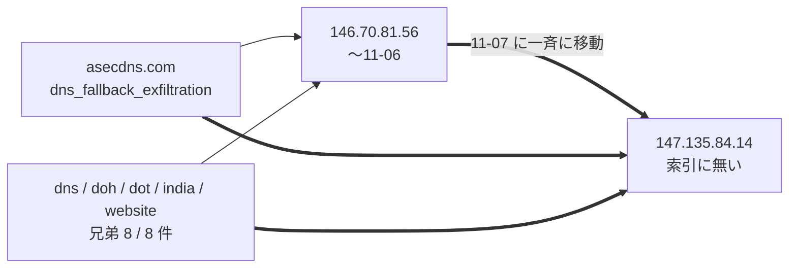
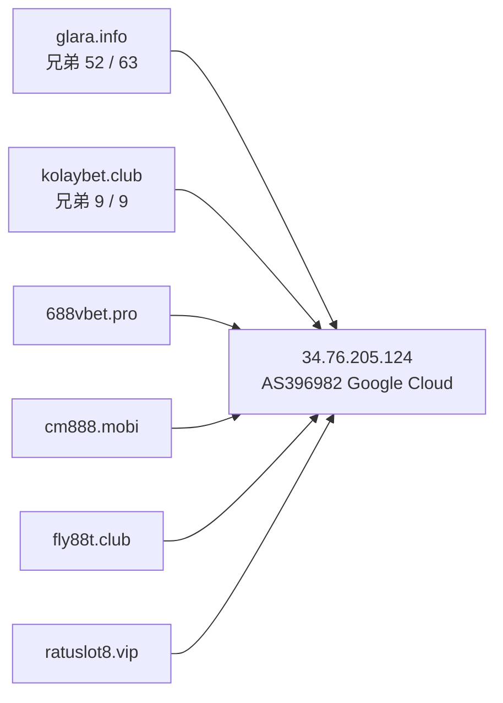
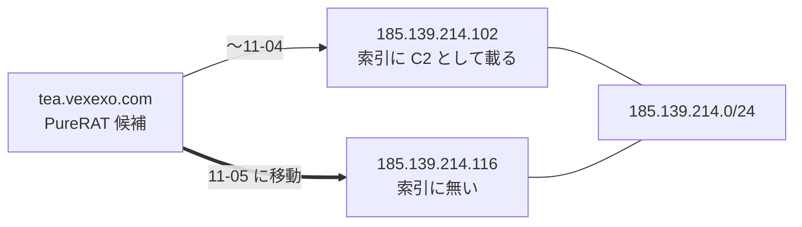
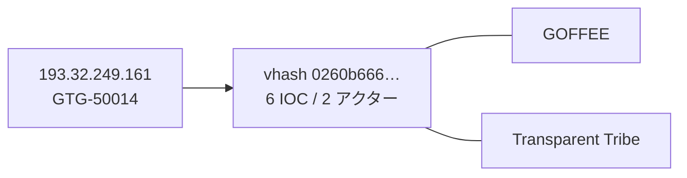

> **このレポートは AI（Claude）が自動生成したものです。人の確認を前提としてください。**

# 週次レポート 2026-W45（2026-11-01 〜 2026-11-07）

## 見つかったもの

### ドメインの生存と切り替わり

**今週のトラッカー（追跡 10,005 ドメイン、観測 7 日）は、役割つきでは薄い。** 変化 1,341 件・
「行き先が変わった」1,240 件のうち、毎日組・事業者・動的 DNS の印が付いたもの
（Google・Microsoft・Steam・GitHub・S3・Vercel・Cloudflare 配下）を除くと、役割つきで IPv4 が
動いたのは下の 6 ホストだけ。**落ちた役割つきは 0 件、生き返った役割つきも 0 件**
（落ちた 76 件・生き返った 25 件は全て役割なし）。

**測定側の問題は直っていない。** AAAA と CNAME が取れておらず、「別名の向き先が変わった」は
0 件。変化が無かったのではなく見えていない。**IPv6 と CNAME の変化は所見にしない。**
判定保留は 223 / 10,005 件（2.2%）で、5% の線は超えていない。

- **`genddos.st`（`c2/c2_candidate`）が 11-05 に `176.65.139.194` から `45.198.224.34` へ移った。**
  どちらの IP も索引に無い。旧 IP の /24 には索引の IP が 5 件あるが、アクターの紐づけは無い。
  新 IP の /16 に索引の IP は無い。**関係の根拠は無い**
- **`tea.vexexo.com`（PureRAT/PureHVNC 候補）が 11-05 に `185.139.214.102` から `.116` へ移った。**
  旧 IP は索引にある（アクター紐づけ無し）。同じ /24 内の 同じ /24 内の移動で、引っ越しというより
  同じ業者内の付け替えと読める（妥当）
- **`ftp.dankely.org`（`c2_or_infrastructure_as_record`）が 11-02 に `194.36.191.196` から
  `206.168.149.74` へ移った。** どちらも索引に無い。索引外の検体 19 件が付いている
  （下の「そこから得られそうなもの」）
- **`asecdns.com`（`dns_fallback_exfiltration`）が 11-07 に `146.70.81.56` から `147.135.84.14`
  へ移った。** 兄弟 8 / 8 件（`dns` `doh` `dot` `india` `website` ほか）も同じ日に同じ IP へ
  移った。先週まで兄弟が固まっていた IP が替わったということ（下記）
- **`zjcounty.com`（`payload_distribution_host`）が 11-07 に `156.250.73.75` から
  `156.250.75.207` へ移った。** どちらも索引に無い
- **`cnc.nomeum.net`（`C2/通信`）は 11-04・11-05・11-07 の 3 回、IP の集合が入れ替わった。**
  Amazon のアドレス内の入れ替わりが中心で、移動ではない。`100.61.160.238`（Amazon の帯ではない）が
  11-07 の集合から外れた。**100.61.160.238 が Amazon の帯でない理由は確認していない**
- 上記以外で役割つきに動いたのは `www.s666hn.com` / `s666hn.com`（11-04、Cloudflare の帯の
  中での入れ替わり。`事業者` の印）と `dl.dropboxusercontent.com`（共用基盤）、
  `instance-hhwlfk-relay.screenconnect.com`（ScreenConnect の中継名、`事業者`、Amazon 内の
  入れ替わり）で、いずれも所見にしない

先週取り上げた `utuhv.cn`（`43.156.46.34`）・`eclipse.garden`・`saicetyapy.space`・
`compute.in.net`・`fff-ttt.com` は今週は動いていない。`ftp.hivimer.com` と `ftp.vilimorin.com`
は先週に続き nxdomain のまま。

### 証明書の記録から出た兄弟

**今週は動いていない。新しい兄弟は 0 件。** 役割つき apex は 141 で、今回の取得は
**100 / 141 apex で打ち切られた（レート制限 HTTP 429、先週は 100 / 139）**。読めた 100 apex から
残った兄弟は 221 件（先週も 221 件）で、ホスト名は先週と完全に一致した。読めなかった 41 apex の
分は**消失とは読まない**。

共用基盤と判定された apex は 6 で、**すべて先週の 6 と同じ（新規は無い）**。
`dropboxusercontent.com`（148,334）`42web.io`（46,650）`chickenkiller.com`（41,361）
`netcup.net`（31,745）`4nmn.com`（8,488）`cpolar.top`（563）。

221 件の今の状態は、alive が 82 / 221。`iuqerfsodp9…` の 79 / 79 件・
`789betapps.com` の 15 / 15 件は nxdomain のまま。alive は `glara.info` 52 / 63・
`kolaybet.club` 9 / 9・`asecdns.com` 8 / 8・`magsa.com.pe` 4 / 6 など。

## つながったもの

### `asecdns.com` の兄弟 8 / 8 件が、同じ日に同じ IP へ移った

旧 IP は索引に無いが、同じ /24 に索引の Candiru の IP（`146.70.81.218`）がある。新 IP の /16
には APT28（`147.135.209.245`）と Anonymous（`147.135.112.147`）の IP がある。**どちらも /24 か
/16 の同居でしかなく、/16 は広すぎる帯なので、根拠としては弱い。** 事実として確かなのは
「apex と兄弟 8 件が 1 日で同じ IP に揃って移った」ことだけで、同一運用であることの補強にはなる
（妥当）。AS は写しに無く、持ち主は未確認。

### `34.76.205.124`（AS396982 Google Cloud）に、役割つき 5 apex が同居している（継続）

追跡 69 ホストが解決している（先週 70）。そのうち 61 / 69 が証明書の記録から出た兄弟
（`glara.info` 52、`kolaybet.club` 9）。**IP は索引に無く、/24 も無い**（先週までと同じ足場）。
賭博系の名前で揃っており、同一運用の可能性は妥当。AS 名は先週までの記載を引き継ぎ、今週の写しでは
引き直していない。同じ IP の `gr.com`（共有の接尾辞）と `zu7pl.pro` は材料にしない。

### `tea.vexexo.com` の移動は、索引の C2 と同じ /24 の中で起きた

新しい IP は索引に無いが、旧 IP と同じ /24 にあり、運用の付け替え範囲と読める（妥当）。
アクターの紐づけは旧 IP 側にも無い。

### 新しい橋は 0 件（18 組は先週と同一、`pivot-bridges.jsonl` の中身は 1 行も変わらない）

写し 300 件・索引に無い検体 2,192 件（先週 2,180）・的 150 = IP 120 / ドメイン 30 から、
橋 48 組のうちガードを通ったのが 18 組（既知 5 / 新規 13）、落ちたのが 30 組。新規 13 は先週から
の継続で、**今週増えたものは無い**。

## そこから得られそうなもの

- **`45.198.224.34`（`genddos.st` の移動先）、`147.135.84.14`（`asecdns.com` 一族の移動先）、
  `185.139.214.116`（`tea.vexexo.com`）、`206.168.149.74`（`ftp.dankely.org`）、
  `156.250.75.207`（`zjcounty.com`）はいずれも索引に無い IP。** 次回の手動の的に加える
  （妥当）。とくに `147.135.84.14` は兄弟 8 件が一斉に移った先なので、同居する別 apex が
  見つかれば広がりが引ける
- **`ftp.dankely.org`（`c2_or_infrastructure_as_record`）に付いた索引外の検体 19 件。**
  出ている初観測は 2026-10-15〜22 で（上位 3 件のみ確認）、`ordine_340914.js`（検知 19）・`rylrxx7.exe`（検知 39）・
  PDF 風の名前の検体（検知 25）など。ドメインは alive で、IP が 11-02 に替わった直後なので、
  最近の運用と時期が合う（妥当）。型・サイズの幅は今週は引き直していない
- **生存ドメインに付いた索引外の検体は 30 ドメイン**（先週 28）。役割つきは
  `dl.dropboxusercontent.com`（上限 120 件、共用基盤）・`ftp.dankely.org`・`saicetyapy.space`
  （15 件、初観測は全て 2024-02、今の運用との関係は弱い）・`zjcounty.com`（1 件、2026-07-19、
  検知 8）の 4 つ。残り 26 は役割なしで、単独では追う理由にならない
- **兄弟が固まっている IP の新しい足場は無い。** 上位は `34.76.205.124`（61）・
  `147.135.84.14`（8、`asecdns.com`、**今週移動**）・`192.185.37.239`（4、`magsa.com.pe`）・
  `217.144.107.127`（2）・`103.224.93.246`（2）・`185.207.224.40`（2）で、`147.135.84.14`
  以外は先週と同じ

## 疑い

**`black-popular.com` `us.lenovoappstore.com` `connect-microsoft.com` `samsungcdn.com` の
4 件は、今週も同じ IP に同居している（4 / 4 件が `153.234.87.51`）。** 先週の
`153.248.52.134` から 11-01 に 4 件そろって移った（その前の 10-23 にも
`153.236.181.151` から 4 件そろって移っている）。別アクター 4 つのドメインが 1 つの IP に揃い、
しかも毎回一緒に動くのは、運用の共有というより**シンクホールの受け皿と読むほうが自然
（仮説）**。CNAME が測定できないため再確認はできていない。**この 4 件を 1 つの基盤とも、
アクターの共有とも読まない。**

**`34.41.139.193`（Google Cloud）に、追跡 86 ホストが居る**（先週 80）。apex に直すと 64。
別々のアクターのドメインがこれだけ集まるのは、失効・押収したドメインの受け皿と
読むほうが自然（仮説）。アクター数は今週は引き直していない。

**橋 18 組の検分。顔ぶれ・値とも先週と完全に同じ（`pivot-bridges.jsonl` に差分が無い）ため、
判断は先週を引き継ぐ。** 今週の `value_spread` は今回の橋の行から読み直した。

| 組 | 値 | value_spread | 判断 |
| --- | --- | --- | --- |
| GTG-50014 ↔ Transparent Tribe / GOFFEE | vhash `0260b666…` | 6 IOC / 2 アクター | 妥当（既知の関係の補強。先週 `gkpkyld.exe` 2,186,128 B で確認） |
| GTG-50014 ↔ PhantomEnigma / Rognar | imphash `88016fcd…` | 12 IOC / 4 アクター | 却下（汎用スタブ。先週確認した 32 倍のサイズ幅と 1 検体ごとに違う名前） |
| Chatty Spider ↔ X3D MINER / The Gentlemen | imphash `1aae8bf5…` | 9 IOC / 2 アクター | 妥当（継続、新たな根拠は無い） |
| SMOKE#SCREEN ↔ Storm-2949 | vhash `05605665…` | 3 IOC / 1 アクター | 却下維持（実在の RMM `ScreenConnect.ClientSetup.exe`） |
| Storm-2949 ↔ The Gentlemen | imphash `c2d457ad…` | 3 IOC / 2 アクター | 却下維持（実在 OSS の検体） |
| Golden Chickens ↔ KongTuke / Qilin / TAG-195 | vhash `c0898bab…` | 5 IOC / 1 アクター | 却下維持（サイズが 27 倍開く） |
| APT37 ↔ Chatty Spider / Myxa VPN | imphash `948cc502…` | 4 IOC / 1 アクター | 却下維持（検体フィード名） |
| Chatty Spider ↔ GreyVibe | imphash `f4639a0b…` | 4 IOC / 1 アクター | 却下（約 21 倍のサイズ幅） |
| Myxa VPN ↔ masterblack / Gambling Goblin | vhash `e840a106…` | 7 IOC / 2 アクター | 却下維持（ELF と EXE の混在・実在ツール） |
| FortiBleed ↔ UNK_DeadDrop | vhash `77ac44bd…` | 3 IOC / 1 アクター | 材料不足で判断保留 |
| Exvicy ↔ UAT-6275 | vhash `4ff2a788…` | 8 IOC / 1 アクター | 弱い（却下寄り。数百 B の PowerShell では vhash が形しか見ない） |

今週は検体の名前・型・サイズの幅を引き直していない（橋の値が先週と同一のため）。

**毎日組は 154 件**（観測 7 日のうち 4 日以上動いたもの、追跡 10,005 件中。先週は 153 件）。
役割つきで印が付いたものに `drive.google.com` `gist.github.com` `microsoft.com`
`steamcommunity.com` `cleverstack-ext30341.vercel.app`
`xjsjkjdsjjd.s3.ap-southeast-1.amazonaws.com` があり、行き先が毎日入れ替わる事業者・配信基盤の
構成。**所見にしない。**
