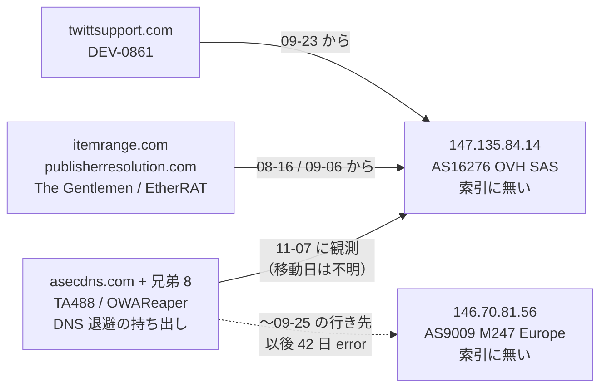
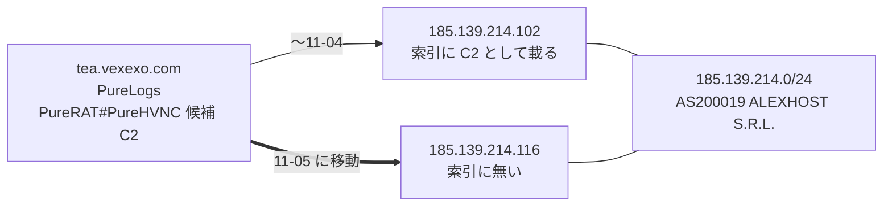
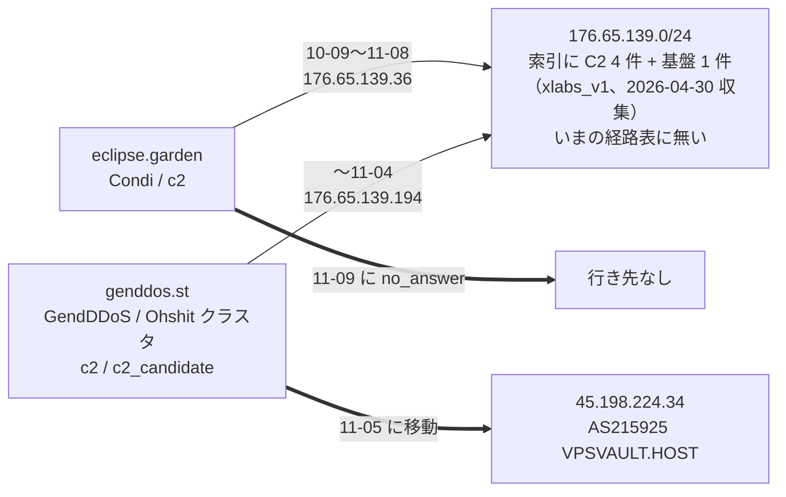
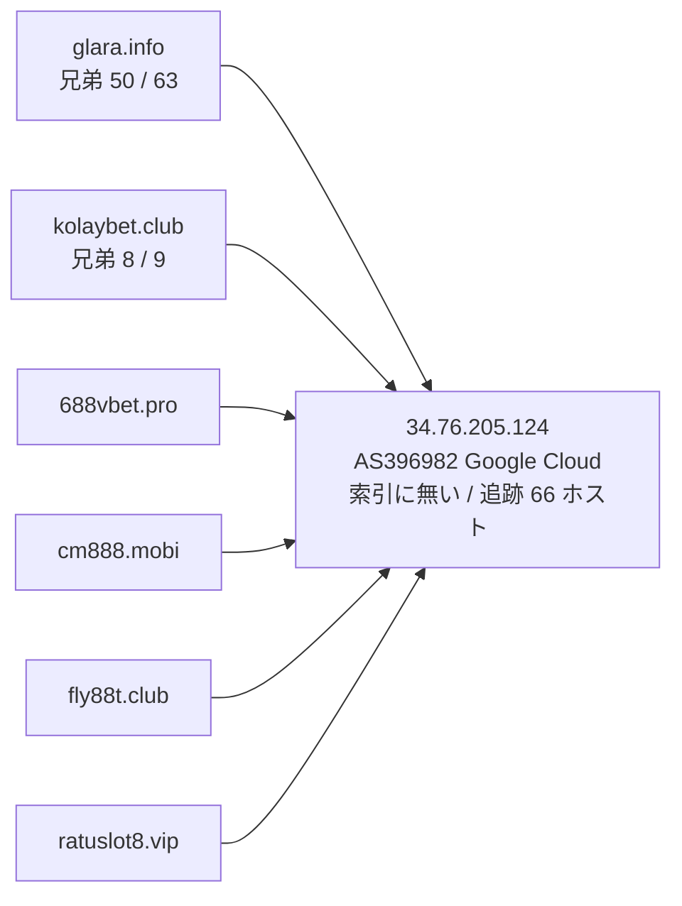
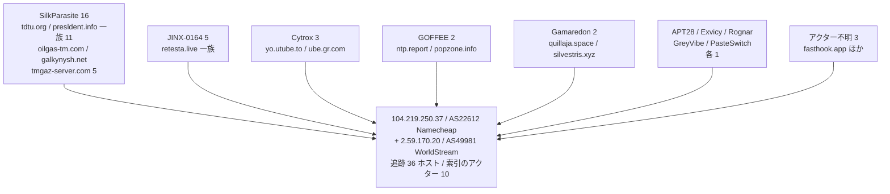
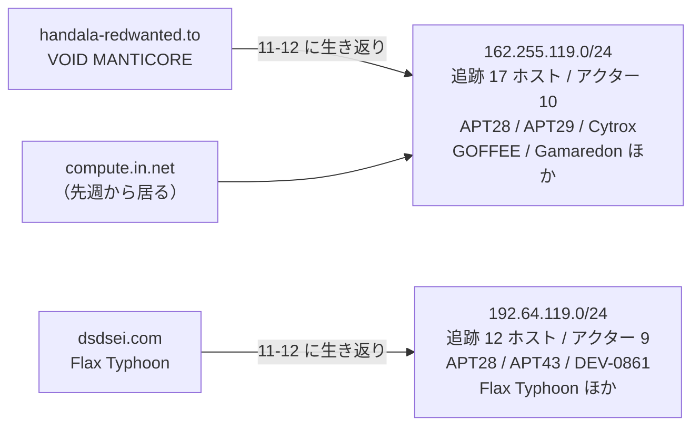
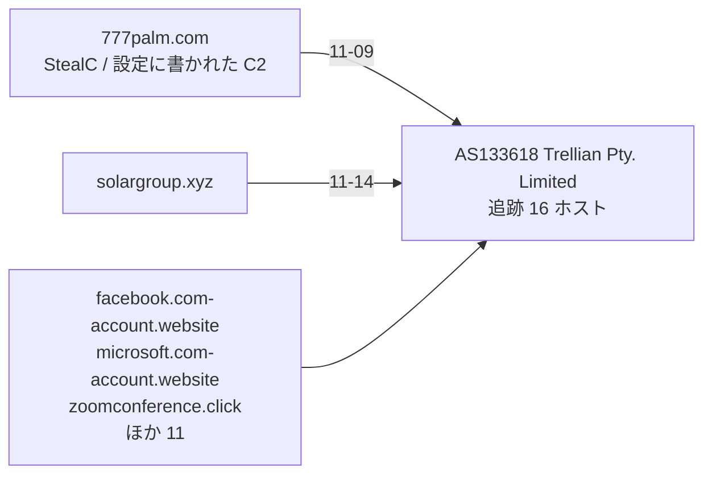
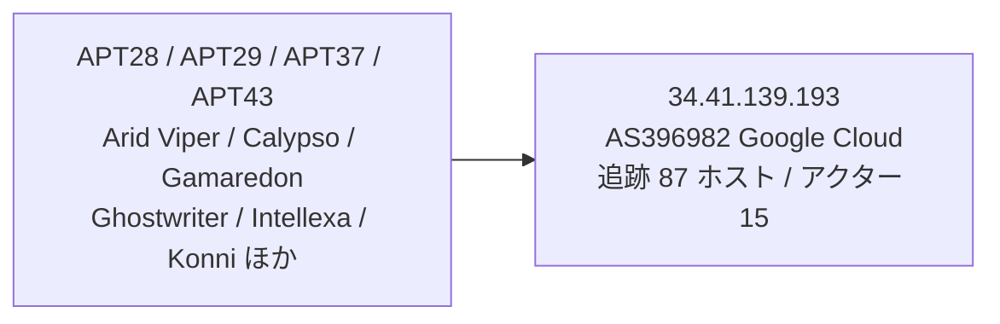
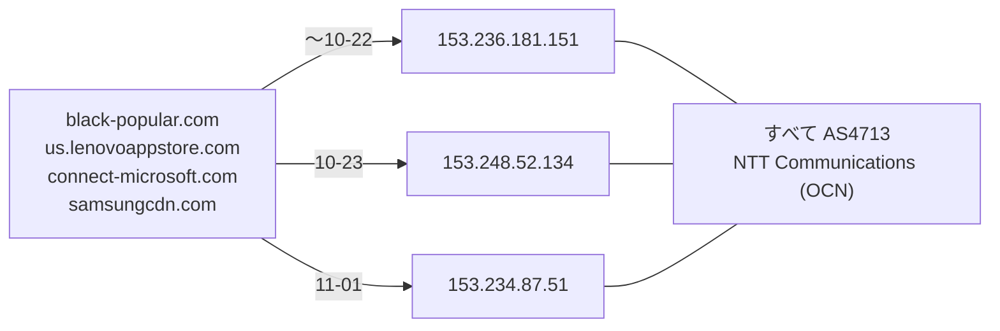

> **このレポートは AI（Claude）が自動生成したものです。人の確認を前提としてください。**

# 週次レポート 2026-W46（2026-11-07 〜 2026-11-14）

## 見つかったもの

### ドメインの生存と切り替わり

**今週のトラッカー（追跡 10,086 ドメイン、観測 7 日: 11-07・11-08・11-09・11-11・11-12・11-13・11-14）は
変化 420 件。役割つきで印の無い移動は 4 件 / 3 ホストだけ**で、役割つきは薄い。
11-10 は観測が無い（その日のぶんは「動いていない」ではなく「見ていない」）。

- **`asecdns.com`（TA488 / OWAReaper、`dns_fallback_exfiltration`）が `147.135.84.14`
  （AS16276 OVH SAS）に居る。証明書の記録から出た兄弟 8 件も同じ 1 つの IP に揃っている
  （9 / 9 ホストが `147.135.84.14`）。** 前に観測できていた行き先は `146.70.81.56`
  （AS9009 M247 Europe SRL）。**ただし移動した日は分からない** —— このドメインは
  09-26 から 11-06 まで 42 日間ずっと `error`（SERVFAIL / タイムアウト）で、
  11-07 が久しぶりに答えた日にあたる。道具は 11-07 の `as_change`（9009 → 16276）として
  記録しているが、**実際に替わったのは 42 日の空白のどこか**（妥当）。
  新旧どちらの IP も索引に無い。11-07 以降 7 観測日すべて同じ IP で動いていない
- **`zjcounty.com`（`payload_distribution_host`）が 9 日で 3 回移った。**
  `156.250.73.75`（AS142286 LUOGELANG (FRANCE) LIMITED）→ 11-06 `156.250.75.207`（同 AS）
  → 11-09 `107.151.224.53`（AS62468 VpsQuan L.L.C.）→ 11-11 `177.211.76.79`
  （AS134175 DingFeng XinHui）。**AS を 3 つまたいでいる**ので同一事業者の中の
  入れ替わりではない。4 つの IP はいずれも索引に無く、同じ /24 に索引の IP も無い。
  追跡開始からの変化は 7 回で、**今週がいちばん速い**
- **`777palm.com`（StealC、`c2_domain_from_static_config`）は 11-09 に
  `216.230.234.132`（AS40156 The Optimal Link Corporation）から `103.224.182.249`
  （AS133618 Trellian Pty. Limited）へ移った。これは運用の移動ではなく失効（妥当）** ——
  AS133618 には他に 15 件の追跡ドメインが落ちており
  （`facebook.com-account.website` `microsoft.com-account.website` `zoomconference.click`
  `solargroup.xyz` など、互いに無関係な名前）、パーキングの受け皿の形。「疑い」に再掲

**落ちたもの。** 落ちた 46 件のうち役割つきは 4 件。

- `xoilactv1.asia` と `www.xoilactv1.asia`（`nanocore_configured_controller`）が
  11-14 に揃って nxdomain。11-05 に Cloudflare の背後で観測され始めて 9 日で消えた
- `ftp.ltcresource.com.my`（Agent Tesla、`c2_or_infrastructure_as_recorded`）が 11-12 に nxdomain
  （直前の行き先は `218.208.91.138`）
- `eclipse.garden`（Condi、`c2`）が 11-09 に no_answer。10-09 に `176.65.139.36` へ移ったもので、
  **その /24 ごと経路が消えている。同じ /24 に `genddos.st` も居た**ので「つながったもの」に図を置く

**生き返ったもの 22 件（21 ホスト。`srv166997.hoster-test.ru` は 11-08 と 11-12 の 2 回）は、
すべて `役割なし` の印が付いている。** ただし印が付いた理由は「索引が役割を述べていない」だけで、
**21 ホストのうち 16 ホストには索引がアクターを与えている**
（`SilkParasite` 8・`Gamaredon` 2・`SilentDelivery` `Candiru` `Flax Typhoon`
`VOID MANTICORE` `GTG-50014` `GOFFEE` 各 1）。
**それでも所見にはできない。21 ホストのうち 9 ホストは 1 つの IP へまとめて到着したもの**
（11-08 に `104.219.250.37` へ 14 件が同時。SilkParasite 8 件と GOFFEE の `popzone.info`）で、
生き返りではなく受け皿への落下。「疑い」に書く。
さらに `handala-redwanted.to`（VOID MANTICORE、`162.255.119.52`）と `dsdsei.com`
（Flax Typhoon、`192.64.119.197`）の 2 ホストも **Namecheap のパーキングの帯**に入った
（「疑い」に再掲）。残るアクターつきは 5 ホストで、`astorialaza.com`（SilentDelivery、
`94.130.200.83` / Hetzner）`commonclever.com`（Candiru、`2.57.91.91` / Hostinger）
`emailinfo.site`（Gamaredon、`13.140.56.203` / Contabo Asia）`mozilla.ws`（GTG-50014、
`3.33.139.32` / Amazon）`srv166997.hoster-test.ru`（Gamaredon、11-13 に再び nxdomain）。
**行き先はいずれも索引に無く、役割も述べられていない**ので、単独では追う理由にならない。

**先週（2026-W45）のレポートは無いため、11-01 〜 11-06 の役割つきの動きもここに載せる。**

- `genddos.st`（GendDDoS / Ohshit クラスタ、`c2` `c2_candidate`）が 11-05 に
  `176.65.139.194`（経路なし）から `45.198.224.34`（AS215925 VPSVAULT.HOST LTD）へ
- **`tea.vexexo.com`（PureLogs、`PureRAT/PureHVNC candidate C2`）が 11-05 に
  `185.139.214.102` から `185.139.214.116` へ移った。移動元は索引に載っている IP で、
  移動先は同じ /24・同じ AS200019 ALEXHOST S.R.L.**（14 アドレスずれただけ）。
  「つながったもの」に図を置く
- `ftp.dankely.org`（Agent Tesla、`c2_or_infrastructure_as_recorded`）が 11-02 に
  `194.36.191.196`（AS60117 Host Sailor Ltd）から `206.168.149.74`
  （AS26042 FiberState, LLC）へ。索引に無い IP
- `www.s666hn.com`（NanoCore、`C2/通信`）が 11-04 に Cloudflare の中で入れ替わった（移動ではない）
- `cnc.nomeum.net`（`C2/通信`）は 11-04・11-05・11-06 の 3 回、Amazon のアドレス内で
  集合が入れ替わった（追跡開始から 28 回）。先週までと同じ構成で移動ではない

**測定側の問題は先週から直っていない。** CNAME・AAAA・NS が取れていない
（11-14 の観測 10,010 件のうち `cname` が ENODATA 9,728 件・`aaaa` が 9,954 件・`ns` が 9,716 件）。
`cname_change` の記録は **2026-10-08 が最後**で、今週の「別名の向き先が変わった」は 0 件。
**変化が無かったのではなく見えていない。IPv6 と CNAME の変化は所見にしない。**
判定保留は 222 / 10,086 件（2.2%）で、5% の線は超えていない。

### 証明書の記録から出た兄弟

**今週は 1 件も動いていない。** `crtname.jsonl` は先週と 1 バイトも違わず、
**新しい兄弟は 0 / 221 件**。役割つき apex は 141 に増えたが、取得は先週と同じく
**100 / 141 apex で打ち切られた（HTTP 429、1 件は取得失敗）**。打ち切りは名前順なので
`riverhasus.com` 以降の 41 apex は今週も読めていない。**読めなかったぶんは消失と読まない。**

共用基盤と判定された apex は 6 で、**新しく共用基盤と判定された apex は無い**（先週の 6 と同一）。
`dropboxusercontent.com`（148,334）`42web.io`（46,709）`chickenkiller.com`（41,925）
`netcup.net`（31,817）`4nmn.com`（8,489）`cpolar.top`（563）。のべ 278,330 ホストを見て
事業者既定の名前 193 件を落とし、221 件が残った。

221 件のうち**生きているのは 79 件**で、解決先は **11 個の IP** しかない。固まり方はこうなる。

| IP | 兄弟 | AS | 索引 |
| --- | --- | --- | --- |
| `34.76.205.124` | 58（`glara.info` 50 / `kolaybet.club` 8） | AS396982 Google Cloud Platform | **無い** |
| `147.135.84.14` | 8（`asecdns.com`） | AS16276 OVH SAS | **無い** |
| `192.185.37.239` | 4（`magsa.com.pe`） | AS31898 Oracle Cloud | **無い** |
| `217.144.107.127` | 2（`4bagh.net`） | AS204213 Netmihan Communication Company | **無い** |
| `103.224.93.246` | 2（`cyberflor.co`） | AS151406 Yeahhost Sdn Bhd | **無い** |
| `185.207.224.40` | 2（`elpasohonroso.com`） | AS205035 LucusHost SL | **無い** |

残りは 1 件ずつ（`alpharush.ai` と `geschmeidig6307-kotyatanet.sbs` は Cloudflare の背後、
`pameva.com` は `80.237.138.5` / AS34011 Host Europe GmbH）。
死んでいる側は `iuqerfsodp9…` の 79 / 79 件・`789betapps.com` の 15 / 15 件・
`orangesac.com` の 6 / 6 件が nxdomain で、固まる IP すら無い。
先週 alive だった `cdn.kolaybet.club` は 11-13 に no_answer になった（9 → 8）。

## つながったもの

### `asecdns.com`（TA488）の行き先に、The Gentlemen と DEV-0861 が先に居た

`147.135.84.14` に居る追跡ホストは **12 件**（`asecdns.com` 一族 9 / The Gentlemen 2 / DEV-0861 1）で、
**索引のアクター 3 つが 1 つの IP に揃っている**。到着は 08-16・09-06・09-23・11-07 と
ばらけており、同じ日にまとめて現れる押収やシンクホールの形ではない。
一方で OVH の 1 IP に 12 ホストというのは**共用ホスティングでも普通に起こる数**なので、
「3 アクターが同じ基盤を使っている」とまでは言えない。**同じ箱か同じ再販業者を踏んでいる、
という程度（妥当）。** `147.135.84.14` も `147.135.84.0/24` も索引に無い。

### `tea.vexexo.com`（PureLogs）は索引の IP から 14 アドレス隣へ移った

同じ /24・同じ AS の中で 14 アドレスずれただけで、**同じ足場を使い続けていると読める（妥当）**。
`185.139.214.0/24` に索引が持っている IP は移動元の 1 件だけ
（`185.139.214.102`、出典 `ai-security-analysis` / `tech-memo-daily-news`）。

### `176.65.139.0/24` に Condi と GendDDoS が同居していて、その /24 ごと経路が消えた

**別々の DDoS 一族（Condi と GendDDoS / Ohshit クラスタ）の C2 が同じ /24 に居た。**
索引はこの /24 に 5 件の IP を持っている（`176.65.139.9` `.42` `.44` `.134` が `c2`、
`.31` が `infrastructure`。マルウェア名は `xlabs_v1`、収集は 2026-04-30）が、
**2 ドメインが実際に使っていた `.36` と `.194` は索引に無い。**
今日の経路表に `176.65.139.0/24` は無く（隣の `176.65.140.0/24` は
AS58232 Parsun Network Solutions PTY LTD で生きている）、
`genddos.st` が 11-05 に別の AS へ移り、`eclipse.garden` が 11-09 に行き先を失ったのは
**この /24 の消滅で説明がつく（妥当）。** 2 つの一族が同じ業者を使っていたことは言えるが、
同じ運用者とまでは言えない（弱い）。

### `34.76.205.124`（AS396982 Google Cloud）に AsyncRAT の 6 apex が同居している（継続）

6 apex はすべて索引で **AsyncRAT の `configured_c2`**。追跡 66 ホストが解決しており
（先週 70）、うち 58 件が `glara.info` と `kolaybet.club` の証明書の兄弟。
**IP も /24 も索引に無く、先週までと同じ足場。** 賭博系の名前で揃っているので
同一運用の可能性は妥当。同じ IP に `viva.gr.com`（Cytrox）と `zu7pl.pro`（AnonyMousTeam）も
居るが、この 2 件は別アクターで、**1 件ずつしか居ないので材料にしない。**

**ピボットからは、つながりとして書けるものは今週は出なかった。**
橋は 19 組通ったが、**先週に無かったのは `Myxa VPN ↔ OceanGate` の 1 組だけ**で、
しかもそれは**先週すでに却下した値 `e840a106…` の上に出たもの**（同じ vhash の
`Myxa VPN ↔ masterblack` と `Gambling Goblin ↔ Myxa VPN` の広がりが 7 IOC / 2 アクターから
8 IOC / 3 アクターに増え、その 3 番目として現れた）。**ガードを通ったこと自体は根拠にしない。**
19 組すべての検分は「疑い」に置く。
（写し 300 件 / API 332 回・索引に無い検体 2,219 件・的 150 = IP 120 / ドメイン 30 から、
組 49 のうち通ったのが 19、既知 5 / 新規 14、落ちた 30）

## そこから得られそうなもの

- **`147.135.84.14`（AS16276 OVH SAS）を次の手動の的にする（妥当）。** 索引に無い。
  TA488 の `asecdns.com` 一族 9 ホストに加えて The Gentlemen の 2 件・DEV-0861 の 1 件が
  居るので、**この IP の居住者を引けば索引に無いホストが出る可能性がある**。
  到着がばらけている（08-16 / 09-06 / 09-23 / 11-07）ぶん共用ホスティングの線も残るため、
  まず同居の性格を確かめるのが先
- **`ftp.dankely.org`（Agent Tesla）に付いた索引外の検体 21 件が、今週いちばん新しい入口（妥当）。**
  初観測が **2026-08-05 〜 2026-11-05** に収まっており、先週挙げた `saicetyapy.space` の
  20 か月前の検体とは違って**いまの運用に近い**。名前は請求書・給与明細の釣りで、
  言語が混ざっている（`orden de compra #000790650.xlam`・
  `SOLICITUD DE PRESUPUESTO 08978.xlam`・`Nomina 29.10.2026.xml.uu`・
  `Εκκαθαριστικό_Μισθοδοσίας_22-10-2026.pdf.jse`・`ordine_340914.js`）。
  **vhash `541915dcfead7b69…` が 3 件で共通**（`rylrxx7.exe` 検知 39 /
  `orden de compra #000790650.xlam` 検知 34 / `SOLICITUD DE PRESUPUESTO 08978.xlam` 検知 36）で、
  同族を引く入口になる。ただし 1 件が .exe、2 件が .xlam と型が混ざっているため、
  この vhash が同一ビルダーを指すかは**未確認（弱い）**
- **`zjcounty.com` の新しい 3 つの IP（`156.250.75.207` `107.151.224.53` `177.211.76.79`）。**
  いずれも索引に無く、同じ /24 に索引の IP も無い。3 つの AS をまたいでいるので、
  **どれか 1 つに他の配布ホストが同居していれば一族が引ける**（妥当）。
  `177.211.64.0/20`（AS134175 DingFeng XinHui）は経路表の観測数が 20 しかない小さな帯で、
  居住者を数えるには向いている
- **`34.76.205.124` は先週までと同じ足場で、新しい材料は無い。** 兄弟が固まっている IP の
  上位（`147.135.84.14` 8 件・`192.185.37.239` 4 件・`217.144.107.127` 2 件・
  `103.224.93.246` 2 件・`185.207.224.40` 2 件）はいずれも索引に無いが、
  `147.135.84.14` 以外は先週と同じ顔ぶれで動きが無い
- **生存ドメインに付いた索引外の検体は 28 ドメイン**（先週と同数）。役割つきは
  `dl.dropboxusercontent.com`（120 件・共用基盤なので材料にしない）・`ftp.dankely.org`（21 件）・
  `saicetyapy.space`（15 件・先週と同じ 2024-02 の検体）・`zjcounty.com`（1 件、2026-07-19、
  検知 8、PowerShell）の 4 つ。残り 24 は役割なしで、単独では追う理由にならない

## 疑い

### `104.219.250.37`（AS22612 Namecheap）は、今週の「生き返った」をほぼ説明してしまう

**互いに無関係な 10 アクターのドメインが 1 組の A レコードに集まっており、しかも
到着が波で来ている**（10-28 に 7 件・11-06 に 4 件・**11-08 に 14 件**）。
さらに **11-12 に 36 ホストすべてから `2.59.170.20` が同時に外れた**。
これは運用の共有ではなく、**失効・押収したドメインの受け皿（シンクホールや登録事業者の保留）と
読むほうが自然（妥当）。**

その結果として、**今週「生き返った」22 件のうち 9 件はこの受け皿への到着**
（`tdtu.org` `info.tdtu.org` `kg.tdtu.org` `mineconom.tdtu.org` `ud.tdtu.org`
`presldent.info` `chief.presldent.info` `it.presldent.info` / GOFFEE の `popzone.info`）。
**SilkParasite が戻ってきたと読んではいけない。**
なお `104.219.250.37` も `2.59.170.20` も、道具のパーキング受け皿の一覧に入っていないため
状態は `alive` と出ている。

### Namecheap の `162.255.119.0/24` と `192.64.119.0/24` もパーキングの帯

どちらも AS22612 Namecheap で、**1 ドメインが /24 の中の別々の 1 アドレスを持つ**という
登録事業者のパーキングの形。無関係なアクターが 9〜10 並ぶ。
`104.219.250.37` が 1 アドレスに集める形とは違うが、**読み方は同じで、所見にしない。**

### `103.224.182.0/23` ほか AS133618（Trellian）はパーキングの受け皿

AS133618 に落ちている 16 ホストは互いに無関係で、**フィッシング風の名前と失効待ちの名前が
混ざっている**。`777palm.com` の 11-09 の「移動」と `solargroup.xyz` の 11-14 の
「AS が変わった」は、いずれも**この受け皿への落下（妥当）。所見にしない。**

### `34.41.139.193`（Google Cloud）は今週も増えている

先週 80 ホストだったものが **87 ホスト / 索引のアクター 15** になった。
`104.219.250.37` と同じ形（別々のアクターが 1 つの IP に集まる）で、
**受け皿と読むほうが自然（妥当）。** apex ごとの内訳は今週は引き直していない。

### NTT OCN の 4 ホストは、揃って動くので同じ 1 台の動的 IP に見える

先週「シンクホールの受け皿」と書いた 4 件だが、**3 つの IP すべて AS4713（NTT OCN）の中で、
4 件が同じ日に揃って移っている。** 受け皿なら無関係なドメインが別々の日に集まるはずで、
この動き方は**同じ 1 台（または同じ契約）の動的 IP が付け替わったと読むほうが自然（妥当）。**
先週の「シンクホール」という読みは**この動き方では支持されない。**
4 件は 11-01 以降 11-14 まで同じ IP で動いていない。

### 先週の「`utuhv.cn` の移動先と同じ /16 に別アクターの C2」は取り下げる

先週は `43.156.46.34` の AS が写しに無いと書いたが、今週の経路表では
**AS132203 Tencent（`43.156.0.0/18`）**。同じ /16 に居る `43.156.59.110`（SLOTAGENT）と
`43.156.77.97`（TA4922 / RomulusLoader）も**同じ Tencent**で、
つまり「同じクラウド事業者の客が 3 件」という以上のことは言っていない。
**関係の根拠にはならない（却下）。** `utuhv.cn` は 10-27 以降 `43.156.46.34` で動いていない。

### 橋 19 組の検分（**どれも所見にできない**）

写しから検体の型・サイズ・名前を引き直した。**値を共有している索引側の IOC の
サイズの幅**を母数つきで出すと、ほとんどが汎用スタブか実在ツールだった。

| 組 | 値 | 索引側のサイズの幅 | 判断 |
| --- | --- | --- | --- |
| GTG-50014 ↔ PhantomEnigma / Rognar | imphash `88016fcd…` | 10 IOC・2,062,610 〜 65,923,944 B（**32.0 倍**） | **却下**（汎用スタブ。名前が 1 検体ごとに別の釣り —— `Adobe_Acrobat_Reader_Plugin_ru.exe` `AFTEL_VPN_Setup.exe` `JitsiMeet-Setup.exe` `MOFA_Employee_Benefits_.exe` `TMS_AfghanTelecom.exe`。先週の 32 倍を今週の写しで再確認） |
| Myxa VPN ↔ masterblack / Gambling Goblin / **OceanGate（新規）** | vhash `e840a106…` | 8 IOC・5,750,968 〜 76,251,320 B（**13.3 倍**） | **却下**（8 件すべて ELF で、`rclone`（検知 0）`gowitness-3.1.1-linux-amd64` `reversessh` と**実在の OSS 道具**が混ざる。先週「ELF と EXE の混在」と書いたのは誤りで、**混在ではなく実在ツールと 13 倍の幅**が理由） |
| Golden Chickens ↔ KongTuke / Qilin / TAG-195 | vhash `c0898bab…` | 3 IOC・48,128 〜 1,298,432 B（**27.0 倍**） | **却下維持**（先週の 27 倍を再確認。拾った 2 件はどちらも 49,152 B の `.msi`） |
| Chatty Spider ↔ GreyVibe | imphash `f4639a0b…` | 3 IOC・16,668,268 〜 17,488,792 B（1.0 倍） | **却下**（索引側は揃っているが `K-Lite_Codec_Pack_1905_Basic.exe` と `letsvpn`（検知 2）という**実在のインストーラ**。拾った側は 820,171 B で、こちらと比べると 21.3 倍） |
| APT37 ↔ Chatty Spider / Myxa VPN | imphash `948cc502…` | 2 IOC・915,968 B（同一） | **却下**（族名が `autoit`。**AutoIt で固めた実行体の既定の取り込み表**で、同じ作者を指さない） |
| SMOKE#SCREEN ↔ Storm-2949 | vhash `056056655d…` | 2 IOC・5,657,864 〜 5,689,656 B（1.0 倍） | **却下維持**（族名が `connectwisecontrol` / `sconnect`、拾った検体は `ScreenConnect.ClientSetup.exe`。実在の RMM） |
| Storm-2949 ↔ The Gentlemen | imphash `c2d457ad…` | 2 IOC・1,947,136 〜 18,185,728 B（**9.3 倍**） | **却下維持**（拾った検体は `tor-relay-scanner-go-windows-amd64.exe`。実在の OSS） |
| Exvicy ↔ UAT-6275 | vhash `4ff2a788…` | 3 IOC・1,144 〜 1,632 B（1.4 倍）＋拾った 5 件が 260 〜 273 B | **却下**（合わせると 260 〜 1,632 B で 6.3 倍。**数百 B の PowerShell では vhash が形しか見ない**。拾った 5 件の検知は 0 〜 5） |
| GTG-50014 ↔ Transparent Tribe / GOFFEE | vhash `0260b666…` | 9 IOC・2,062,610 〜 2,866,176 B（1.4 倍） | **弱い（先週の「妥当」を下げる）**。サイズは揃っているが、**9 件の族名が `fugrafa` `havoc` `sidecopy` `reverseshell` `etherhiding` `tedy` と散っており、この vhash はアクターを指していない**。この 2 組はどちらも索引で既に結ばれた組（`known_pair`）なので、補強にもならない |
| Chatty Spider ↔ X3D MINER / The Gentlemen | imphash `1aae8bf5…` | 8 IOC・1,762,432 〜 3,885,056 B（2.2 倍） | **弱い（先週の「妥当」を下げる）**。8 件の族名が **LummaStealer 4 件**と **The Gentlemen / BlackByte ランサム 3 件**にきれいに割れており、**共通の梱包器を指している可能性が高い**。情報窃取とランサムが同じ取り込み表を持つことは同一運用を意味しない |
| FortiBleed ↔ UNK_DeadDrop | vhash `77ac44bd…` | 2 IOC・6,443,170 〜 14,655,650 B（2.3 倍）＋拾った 1 件 6,881,442 B | **判断保留**（3 件しか無く、ELF の族名も `overlord` / `ovrat` と `multiverze` で割れている。先週から材料が増えていない） |

**拾った側で唯一きれいなのは `u2n9l9.exe`（2,186,120 B・検知 25・初観測 2026-10-04）と
`gkpkyld.exe`（2,186,128 B・検知 25・初観測 2026-10-11）の 2 件**で、サイズが 8 バイトしか
違わず vhash と imphash の両方を共有している。**この 2 件が同じビルドであることは妥当**だが、
**その上に乗っている 4 組の橋はどれも通らない**（`88016fcd…` は 32 倍の汎用スタブ、
`0260b666…` は族名が散る）。`193.32.249.161`（GTG-50014、AS39351 31173 Services AB）から
出ている点は先週と同じ。

### 毎日組

**毎日組は 36 件**（観測 7 日のうち 4 日以上動いたもの、追跡 10,086 件中）。
先週の 153 件とは数え方の前提が違う可能性があるので比べない。
実測どおり `business-data-leaks.com` の一族 6 件（`app.` `demo.` `help.` `id.` `member.` と apex）と
`ep6pheij.com` の一族 3 件（`app.` `assets.` と apex）が 7 / 7 日動いている。
役割つきは `gist.github.com`（`dead_drop_configuration`、6 / 7 日、`事業者` の印）だけ。
**所見にしない。**

