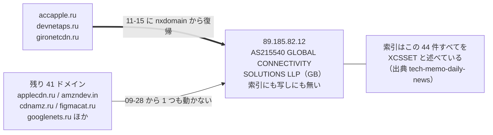
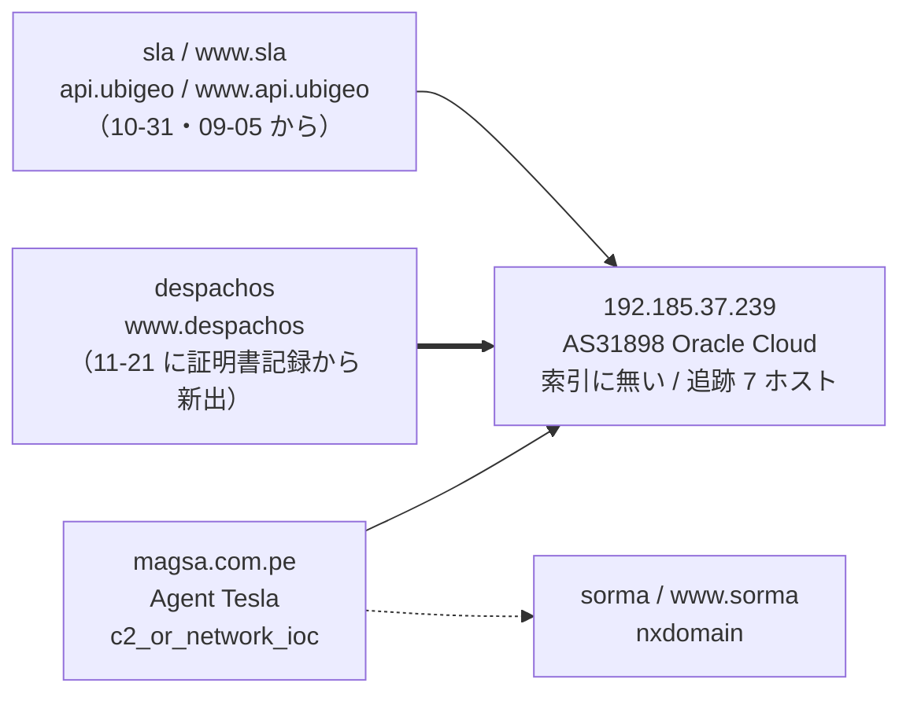
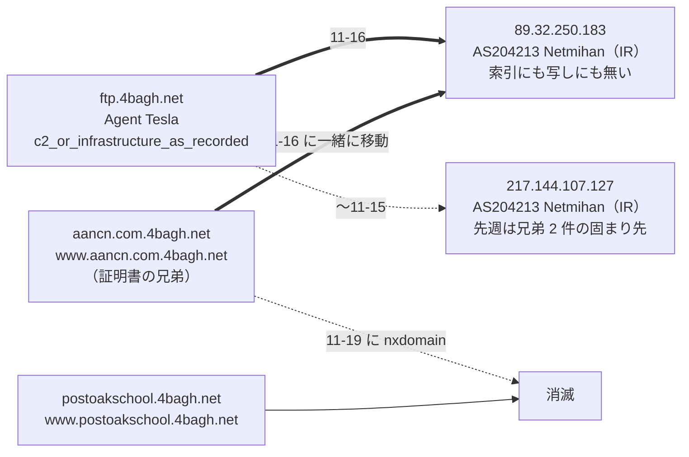
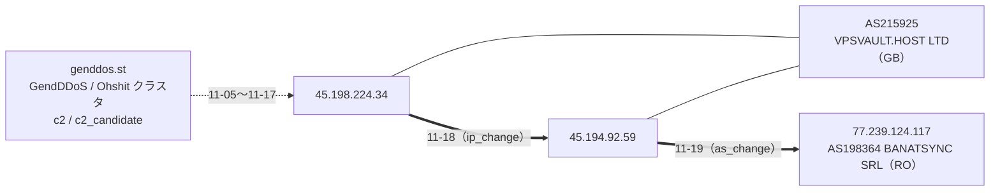
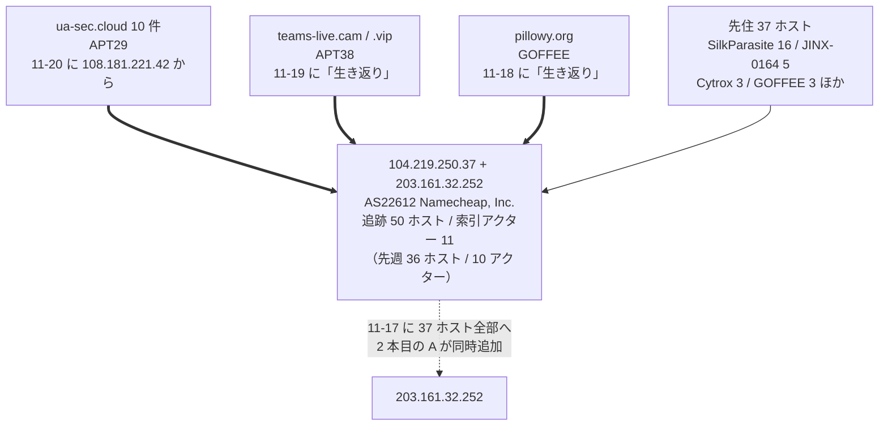
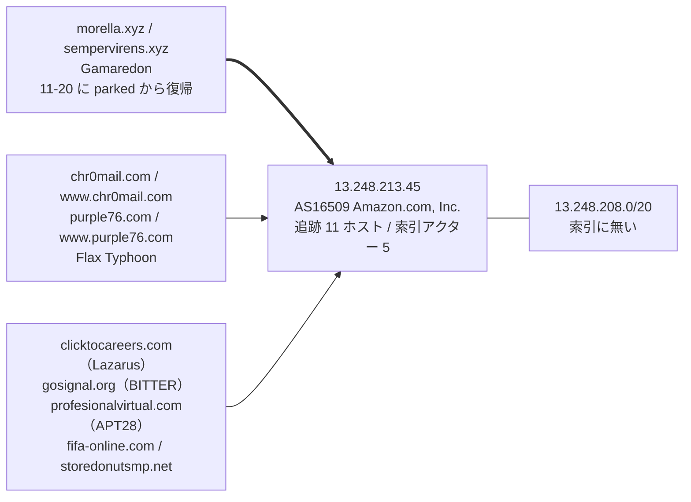
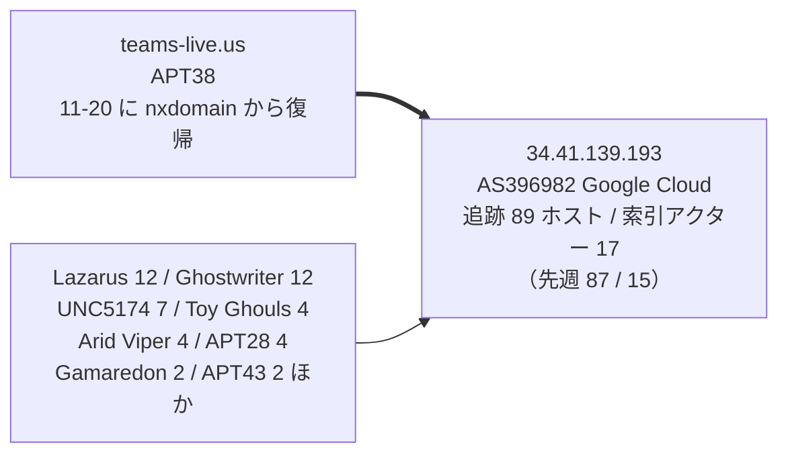
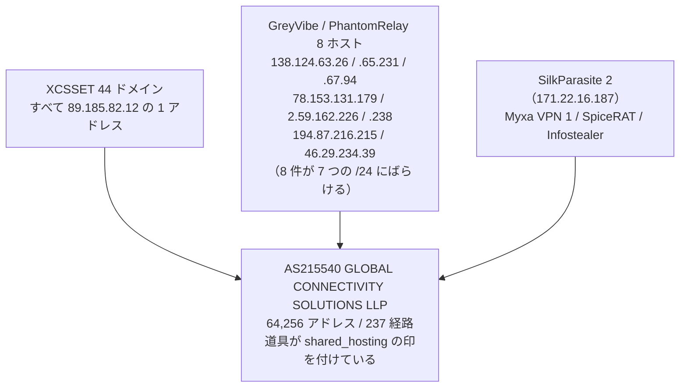

> **このレポートは AI（Claude）が自動生成したものです。人の確認を前提としてください。**

# 週次レポート 2026-W47（2026-11-15 〜 2026-11-21）

## 見つかったもの

### ドメインの生存と切り替わり

**今週のトラッカー（追跡 10,278 ドメイン、観測 7 日: 11-15 〜 11-21 の連続）は変化 483 件。
役割つきの移動は 9 件 / 3 ホストしかなく、そのうち印の無いものは 3 件 / 2 ホスト**
（`genddos.st` 2 件・`ftp.4bagh.net` 1 件。残る 6 件は `gist.github.com` で
`毎日組` `事業者` の両方が付く）。**生き返った 21 件と落ちた 117 件は、1 件も役割を述べられていない。**
役割つきで見るかぎり、**今週は薄い。**

- **`genddos.st`（GendDDoS / Ohshit クラスタ、`c2` `c2_candidate`）が 2 日続けて移った。**
  11-18 に `45.198.224.34` → `45.194.92.59`（**どちらも AS215925 VPSVAULT.HOST LTD**。
  道具は `ip_change` として記録している）、翌 11-19 に `45.194.92.59` → `77.239.124.117`
  （AS198364 BANATSYNC SRL / RO。`as_change`）。
  **追跡開始（08-17）からの変化は 4 回で、そのうち 2 回が今週に集まっている。**
  先週のレポートで書いた `45.198.224.34` には 11-05 から 11-17 までの 13 日しか居なかった。
  新旧の 3 つの IP はいずれも索引（`iocs.jsonl`）に無く、同じ /24 に索引の IP も無い。
  **AS215925 と AS198364 は `asn-cotenancy.jsonl` に出てこない**ので、
  索引はこの 2 つの AS に IP を 1 件も持っていない
- **`ftp.4bagh.net`（Agent Tesla、`c2_or_infrastructure_as_recorded`）が 11-16 に
  `217.144.107.127` → `89.32.250.183` へ移った。これは追跡開始（08-16）から
  92 日で初めての変化で、しかも移動元・移動先が同じ AS204213 Netmihan Communication
  Company Ltd（IR）**。別々の /24 だが同じ事業者の中なので、足場を替えたのではなく
  **同じ契約の中で付け替わったと読むほうが自然（妥当）。** AS204213 も
  `asn-cotenancy.jsonl` に無く、索引はこの AS に IP を持っていない。
  **証明書の兄弟 2 件が同じ日に一緒に移り、3 日後に消えた**ので「つながったもの」に図を置く

**落ちた 117 件。役割つきは 0 件**だが、索引がアクターを与えているものが 49 ホストある。
内訳は `PasteSwitch` 16・`APT38` 6・`Gamaredon` 4・`UAT-6275` 3・`Silver Fox` `GOFFEE`
`GreyVibe` `Discover-Tech` 各 2 ほか。**このうち PasteSwitch の落ち方だけが揃っている。**

- **`PasteSwitch`（AnimateClipper / AMOS / Macsync の macOS 窃取系）の 16 ホストが
  1 週間で落ち、うち 11 ホストが 11-21 の 1 日に集まっている**（日別は 11-17 が 3 件・
  11-18 と 11-19 が 1 件ずつ・11-21 が 11 件）。11-21 に消えたのは `velqo7.co` の 9 件
  （`fd-api-irc` `fd-api-irf` `fd-api-iris` `fd-api-irs` `fd-api-rop` `fd-api-zog`
  `wdm` `wdx` `wix`）と `papartybus.com` `codex-craft.com`。
  **`velqo7.co` の 9 件は前日まで同じ Cloudflare の 1 組**
  （`104.21.52.206` / `172.67.203.167`）**に揃っていて、9 件が同時に nxdomain になった**ので
  DNS 側での一括削除（妥当）。週の前半に落ちたのは `fd.gstats-api-contact.cc`（11-19）
  `cli-guides.com`（11-18）`cli-stack.com` `macdeveloperhub.com` `macfixguide.com`（11-17）。
  PasteSwitch の追跡 148 ホストは **alive 74 / nxdomain 70** になった
- `APT38` の 6 件は `me-live.xyz` `meet-room.xyz` `room-meet.xyz` `room-on.xyz`（11-19）
  `instantsecscan.xyz`（11-18）`securealliance.xyz`（11-20）。
  **同じ一族の `teams-live.cam` `teams-live.vip` `teams-live.us` は同じ週に「生き返って」
  受け皿に落ちている**ので、「疑い」に再掲する
- `UAT-6275` の 3 件（`serviceupdate.dynns.com` `systeminfo.dynns.com`
  `sysupdate.serveftp.com`）は 11-20 に揃って no_answer。**いずれも動的 DNS の下**なので
  名前としての連続性が無く、**所見にしない**

**生き返った 21 件は 1 件も役割を述べられていない。** 索引がアクターを与えているのは
15 ホスト（`Gamaredon` 4・`APT38` 3・`Silver Fox` `BITTER` `GOFFEE` `China-nexus actor`
`ZooPark` `STAC4749` `Intellexa` `Sidewinder` 各 1）だが、**行き先を見ると大半が受け皿への到着**で、
運用の再開ではない。

- `teams-live.cam` `teams-live.vip`（APT38、11-19）と `pillowy.org`（GOFFEE、11-18）は
  **Namecheap の `104.219.250.37` + `203.161.32.252`**（「疑い」に図）
- `morella.xyz` `sempervirens.xyz`（ともに Gamaredon、11-20）は **同じ `13.248.213.45`**
  （AS16509 Amazon）。この IP には無関係な 5 アクターが同居している（「疑い」に図）
- `teams-live.us`（APT38、11-20）は `34.41.139.193`（AS396982 Google Cloud。
  先週 87 ホストだったものが **89 ホスト / 索引アクター 17**）
- **受け皿でないものは 3 件だけで、しかも 3 件が同じ 1 つの IP に揃っている** ——
  `accapple.ru` `devnetaps.ru` `gironetcdn.ru`（11-15、いずれも XCSSET）が
  `89.185.82.12` へ。**これは受け皿ではなく一族への合流**なので「つながったもの」に図を置く

**測定側は先週から変わっていない。** `別名の向き先が変わった` は今週も **0 件**で、
`cname_change` の記録は **2026-10-08 が最後**。**変化が無かったのではなく見えていない
（CNAME と IPv6 の変化は所見にしない）。** 判定保留は **224 / 10,278 件（2.2%）**で
5% の線は超えていない。生存 3,779 件の内訳は CDN 2,236 / 動的 DNS 351 / 事業者 1,001。

### 証明書の記録から出た兄弟

**新しい兄弟は 2 / 223 件**で、どちらも `magsa.com.pe`（Agent Tesla、`c2_or_network_ioc`）の
`despachos.magsa.com.pe` と `www.despachos.magsa.com.pe`。**ほかの 221 件は先週と同一。**
取得は先週と同じく **100 / 141 apex で打ち切られた（HTTP 429、1 件は取得失敗）**。
打ち切りは名前順なので `riverhasus.com` 以降の 41 apex は今週も読めていない。
**読めなかったぶんは消失と読まない。**

**新しく共用基盤と判定された apex は無い**（先週の 6 と同一）。
`dropboxusercontent.com`（148,334）`42web.io`（46,758）`chickenkiller.com`（42,182）
`netcup.net`（31,849）`4nmn.com`（8,489）`cpolar.top`（602）。
のべ 278,709 ホストを見て事業者既定の名前 193 件を落とし、223 件が残った。

223 件のうち**生きているのは 77 件**（先週 79）で、解決先は **10 個の IP** しかない。

| IP | 兄弟 | AS | 索引 | 先週 |
| --- | --- | --- | --- | --- |
| `34.76.205.124` | 56（`glara.info` 49 / `kolaybet.club` 7） | AS396982 Google Cloud Platform | **無い** | 58 |
| `147.135.84.14` | 8（`asecdns.com`） | AS16276 OVH SAS | **無い** | 8 |
| `192.185.37.239` | 6（`magsa.com.pe`） | AS31898 Oracle Cloud | **無い** | 4 |
| `103.224.93.246` | 2（`cyberflor.co`） | AS151406 Yeahhost Sdn Bhd | **無い** | 2 |
| `185.207.224.40` | 2（`elpasohonroso.com`） | AS205035 LucusHost SL | **無い** | 2 |
| `80.237.138.5` | 1（`pameva.com`） | AS34011 Host Europe GmbH | **無い** | 1 |

残り 2 件は Cloudflare の背後（`alpharush.ai` と `geschmeidig6307-kotyatanet.sbs` の
兄弟 1 件ずつが、それぞれ 2 アドレスを返している）。
**先週の表にあった `217.144.107.127`（AS204213 Netmihan）が消えた** ——
`4bagh.net` の兄弟 4 件（`aancn.com.4bagh.net` `www.aancn.com.4bagh.net`
`postoakschool.4bagh.net` `www.postoakschool.4bagh.net`）が**全部 nxdomain になった**ためで、
前 2 件は 11-19 に落ちている。死んでいる側では `iuqerfsodp9…` の 79 / 79 件・
`789betapps.com` の 15 / 15 件・`orangesac.com` の 6 / 6 件が引き続き nxdomain。
`glara.info` は 49 / 63 件が生きており、`pdf.glara.info` が 11-21 に no_answer になった（50 → 49）。

## つながったもの

### XCSSET の 44 ドメインが 1 つの IP に乗っていて、今週その上に 3 件が戻った

**索引は 44 のドメインを XCSSET として持っているのに、44 件が揃って解決している
`89.185.82.12` を持っていない。** しかも `iocs.jsonl` にも `derived-iocs.jsonl` にも無い ——
VT の受動 DNS はこれらのドメインに別々の古い IP を返しており
（`accapple.ru` → `178.208.92.95`、`applecdn.ru` → `151.243.109.188`、
`devnetaps.ru` → `95.142.35.34`、`gironetcdn.ru` → `172.236.104.157` ほか）、
**44 件の集中は毎日の A レコード観測でしか見えていない。**

名前は事業者の騙りで揃っている（`applecdn.ru` `cdnapple.in` `amzndev.ru` `amznprod.in`
`cdnamz.ru` `googlenets.ru` `figmacat.ru` `figmanets.in`、TLD は `.ru` 23 / `.in` 21）。
到着は **09-28 に 41 件が一斉**で、11-15 に 3 件が加わって 44 件（観測は 11-21 まで途切れない）。

**ここで自分の読みを疑う必要がある。「多数のドメインが同じ日に 1 つの IP へ揃って来る」のは、
このレポートが下の「疑い」で受け皿（失効・押収の受け皿）と呼んでいる形そのものである。**
そう読まない理由は 3 つで、どれも受け皿側には当てはまらない。

1. **44 件が 1 つのマルウェアだけに結び付いている**（XCSSET 44 / 44）。受け皿と呼んだ
   `104.219.250.37` は 11 アクター、`13.248.213.45` は 5 アクターが混ざる
2. **名前の作りが 1 人の手に見える**（事業者の騙り、`.ru` と `.in` の 2 TLD だけ）。
   受け皿側は互いに無関係な名前が並ぶ
3. **AS215540 には別アクターも居るが、それぞれ別の IP に散っている**（後述）。
   受け皿なら 1 つの住所に集める

**それでも「運用の再開」と言い切れるのは 11-15 の 3 件までで、
41 件が 09-28 に一斉に来たことの説明は付いていない（弱い）。**
索引はこの 3 件に役割を述べていないので、**何を再開したのかも分からない。**
`89.185.82.12` を引いて居住者の性格を確かめるのが先（「そこから得られそうなもの」に再掲）。

### `magsa.com.pe`（Agent Tesla）の新しい兄弟も同じ 1 つの IP に居るが、名前は被害者側のもの

今週出た新しい兄弟 2 件は、**どちらもすでに一族が居る `192.185.37.239` に解決した。**
この IP に居る追跡ホストは **7 件で、全部が `magsa.com.pe` の一族**（apex + 兄弟 6）。
他のアクターは 1 件も居ないので、**AS を共有しているだけの同居ではなく同一運用（妥当）。**
`192.185.37.239` は索引（`iocs.jsonl`）に無く、`derived-iocs.jsonl` に
`magsa.com.pe` の `resolves_to` として 1 件だけある。
同じ /24（`192.185.37.0/24`）に索引の IP は無い。

**ただし名前の並びは攻撃者が作ったものに見えない。** `sla` `sorma` `ubigeo`（`ubigeo` は
ペルーの地理コード制度の呼び名）`despachos`（出荷・配送）はいずれも**ペルーの事業者の
社内システムの名前**で、`.com.pe` もそれと揃っている。つまりこの 7 ホストは
**攻撃者が取ったドメインではなく、乗っ取られた正規のホストと読むほうが自然（妥当）** ——
**証明書の兄弟は被害者側の名前**で、`192.185.37.239` は攻撃者の足場ではなく被害者の
共用ホスティングということになる。**この区別は兄弟の固まりを見るときに毎回必要**で、
固まっていること自体は「同じ持ち主」までしか言わない。
索引が `c2_or_network_ioc` と述べているのは apex だけで、兄弟 6 件には何も述べていない。

### `ftp.4bagh.net` は兄弟 2 件と一緒に Netmihan の中で移り、3 日後に兄弟だけ消えた

**3 つのホストが同じ日（11-16）に同じ行き先へ揃って動いたので、名前の持ち主は 1 人（妥当）。**
移動元と移動先は**どちらも AS204213 Netmihan Communication Company Ltd** で、
別々の /24（`217.144.107.0/24` → `89.32.250.0/24`）。
`asn-cotenancy.jsonl` に AS204213 は無く、**索引はこの AS に IP を 1 件も持っていない。**

兄弟の名前（`aancn.com.4bagh.net` `postoakschool.4bagh.net`）は
**他人のドメインを丸ごとラベルに入れる形**で、騙る先が名前に残っている。
11-19 に兄弟 2 件が落ち、**`ftp.` だけが残った** ——
C2 の口は残して釣りの受け皿だけ畳んだ、と読める（弱い）。

### `genddos.st` は VPSVAULT.HOST の中で 1 回動いてから、翌日に国をまたいだ

**11-18 の移動は AS215925 の中（`45.198.224.0/24` → `45.194.92.0/24`）で、
翌日に AS198364 へ出ている。** 同じ事業者の中で 1 回動いてから別の国の事業者へ移る形は、
**元の足場を畳む前に次を試した動き（妥当）。** 追跡開始からの 4 回の変化のうち 2 回が今週で、
**今週がいちばん速い。** 3 つの IP も 3 つの /24 も索引に無く、
**AS215925 と AS198364 はどちらも `asn-cotenancy.jsonl` に無い**（索引はこの 2 AS に IP を持たない）。
`77.239.124.117` は `derived-iocs.jsonl` にも無いので、**今週いちばん新しい足場。**

**ピボットからは、つながりとして書けるものは今週も出なかった。** 橋は 26 組通ったが
（57 組のうち通過 26・既知 7 / 新規 19・全部落ちた 31）、**先週に無かったのは 8 組だけ**で、
その 8 組は **3 つの値の上にしか乗っておらず、3 つとも検分で落ちた**（内訳は「疑い」）。
**ガードを通ったこと自体は根拠にしない。** 26 組すべての検分は「疑い」に置く。
（写し 300 件 / API 328 回・空振り 134・索引に無い検体 2,096 件・
的 150 = IP 120 / ドメイン 30 から）

## そこから得られそうなもの

- **`89.185.82.12`（AS215540 GLOBAL CONNECTIVITY SOLUTIONS LLP）を次の手動の的にする（妥当）。**
  **索引（`iocs.jsonl`）にも VT の写し（`derived-iocs.jsonl`）にも無い**のに、
  索引が XCSSET として持っている **44 / 44 ドメインがここに解決している。**
  この IP の居住者を引けば、**索引に無い XCSSET のドメインが出る可能性が高い**うえに、
  **44 件の一斉到着が運用なのか受け皿なのかの判定にもなる**（居住者が XCSSET だけなら運用、
  無関係な名前が混ざっていれば受け皿）。`89.185.82.0/24` にも索引の IP は無い。
  AS215540 全体では索引の IP が 54 件あるが、道具は `shared_hosting` の印を
  付けているので **AS を根拠には使えない**（後述）
- **`genddos.st` に付いた索引外の検体 120 件が、今週いちばん新しい入口（妥当）。**
  このドメインは今週 2 回移っており、**先週の一覧には無かった**
  （ただし検体の取得は枠の順に進むので、**今週初めて引けただけという可能性も残る**）。
  引けた 10 件は `ohshit.x86_64` `ohshit.arm7` と `fileXXXXXX` 形式の名前で、
  初観測は 2026-06-14 〜 2026-08-16、検知は 3 〜 42。**vhash
  `b4d2a18859a7a2b4340d03e318399423` が 10 件中 5 件で共通**（`filelGKyCx` 検知 37 /
  `filemjt3BT` 検知 38 / `filej43z59` 検知 37 / `file8ybPTO` 検知 36 /
  `fileWDIHhG` 検知 37）で、別に `397d54c63083e25930f53124b80ac614` が 2 件
  （`ohshit.x86_64` 検知 42 / `filejSsM52` 検知 33）。
  **アーキテクチャごとのビルドが vhash で分かれている形で、同一ファミリとしては妥当。**
  `fileXXXXXX` という 1 検体ごとに違う名前は IoT 投下器の一時ファイル名なので、
  **汎用スタブの印ではない。** ただしサイズは写しに無く、**同一ビルダーまでは未確認（弱い）**
- **`77.239.124.117`（AS198364 BANATSYNC SRL / RO）と `89.32.250.183`
  （AS204213 Netmihan / IR）は、索引にも VT の写しにも無い（妥当）。**
  どちらも今週の移動先で、**索引はこの 2 つの AS に IP を 1 件も持っていない**
  （`asn-cotenancy.jsonl` に出てこない）。追跡しているホストも 1 件ずつなので、
  **居住者を数えるには向いている**
- **`192.185.37.239`（AS31898 Oracle Cloud）は優先度を下げる（弱い）。** `magsa.com.pe` の
  7 ホストだけが居て索引にこの IP は無いが、**名前の並びが被害者側の社内システムに見える**
  ので（前述）、引いても出るのは**被害者のサブドメイン**で攻撃者の足場ではない見込み。
  **引く価値があるのは、同じ IP に別の被害者が居るかどうか**（共用ホスティングなら
  同じ侵入経路でほかの客も入られている可能性がある）
- **`PasteSwitch` の別名の付け方が次の apex を当てる鍵になる（妥当）。**
  11-21 に全滅した `velqo7.co` のラベルは `wdm` `wdx` `wix` と `fd-api-{irc,irf,iris,irs,rop,zog}`。
  **同じラベル組が別の apex にも乗っている** —— `wdm.unguidedfreewill.co` と
  `wdx.unguidedfreewill.co`（**どちらも生存**、Cloudflare の `104.21.34.56` /
  `172.67.155.30` に `fcp` `jup` `sdx` `tnt` `dmt` と並ぶ）、`fd.gstats-api-contd.cc`
  （**生存**。`fd.gstats-api-contact.cc` は 11-19 に消えた）、`fd.hugo-lapp.lat`（nxdomain）。
  **apex を使い捨てながらラベルの組は変えない**ので、`wdm` / `wdx` / `fd-api-` を
  鍵にすれば**まだ索引に無い次の apex を先に拾える**
- **生存ドメインに付いた索引外の検体は 28 ドメイン**（先週と同数）。役割つきは
  `dl.dropboxusercontent.com`（120 件・共用基盤なので材料にしない）・
  `genddos.st`（120 件・上記）・`ftp.dankely.org`（21 件・先週と同じ 2026-08 〜 11 の釣り）・
  `saicetyapy.space`（15 件・先週と同じ 2024-02 の検体）・`zjcounty.com`（1 件）の 5 つ。
  残り 23 は役割なしで、単独では追う理由にならない

## 疑い

### Namecheap の受け皿が、今週の変化の 1 割をひとりで作っている

**今週の変化 483 件のうち 50 件（10.4%）が、この 1 組の住所で起きている。**
内訳は 11-17 に**先住 37 ホスト全部へ `203.161.32.252` が同時に足された**こと
（変化として記録されたのは 36 件。残る 1 件は前日に到着した `myexpertforum.com` で、
その日の変化に畳まれている）と、
11-16 の `myexpertforum.com`（APT29。移動元は先週パーキングと書いた
`162.255.119.200`）、11-18 の `pillowy.org`、11-19 の `teams-live.cam` `.vip`、
11-20 の **`ua-sec.cloud` 10 ホスト**（`eu-west-1-aws` `us-east-1-aws` `central-2-aws` など
**AWS のリージョン名を騙る名前**で、索引は APT29 に結び付けている）。

**10 ホストが同じ日に `108.181.221.42`（AS40676 Psychz Networks）から揃って移り、
到着先が 11 アクターの混在する 1 組の住所である**ことから、
これは運用の移動ではなく**失効・押収したドメインの受け皿（妥当）。**
先週は `2.59.170.20` が 11-12 に 36 ホストから同時に外れたが、
**今週 `203.161.32.252` が同じ形で足された**ので、2 本目の住所を入れ替えながら使う運用。
**「APT29 が基盤を替えた」「APT38 と GOFFEE が戻ってきた」と読んではいけない。**
`104.219.250.37` も `203.161.32.252` も、道具のパーキング受け皿の一覧に入っていないため
状態は `alive` と出る。

### `13.248.213.45`（Amazon）の「生き返り」2 件も受け皿

Gamaredon の 2 件が 11-20 に `parked` から復帰した先は、
**互いに無関係な 5 アクター（Flax Typhoon 4・Gamaredon 2・Lazarus `BITTER` `APT28` 各 1）が
同居している 1 つの Amazon のアドレス。** `104.219.250.37` と同じ形なので
**受け皿と読むほうが自然（妥当）。所見にしない。**
`morella.xyz` と `sempervirens.xyz` が**同じ日に同じ住所へ**揃って動いたのも、
運用ではなく一括処理の形。

### `34.41.139.193`（Google Cloud）は今週も増え、APT38 の 1 件を受けた

先週 87 ホスト / 15 アクターだったものが **89 ホスト / 17 アクター**になった。
`104.219.250.37` と同じ形（無関係なアクターが 1 つの IP に集まる）なので
**受け皿と読むほうが自然（妥当）。** `teams-live.us` の「生き返り」はここへの落下で、
**同じ `teams-live.*` 一族の 6 件が同じ週に nxdomain になっている**ことと矛盾しない。

### `AS215540` の XCSSET と GreyVibe の同居は根拠にしない

AS215540 には**生存している追跡ホストが 56 件**あり、XCSSET 44・GreyVibe 8・
SilkParasite 2・Myxa VPN 1 が混ざる。**ただし道具はこの AS に `shared_hosting` の印を
付けており（索引の IP 54 件）、README の線引きどおり AS を根拠には使えない。**
使い方も逆で、**XCSSET は 44 名を 1 アドレスに積み、GreyVibe は 8 件を 7 つの /24 に散らしている。**
**同じ業者から借りているだけで、同じ運用者とは言えない（却下）。**
`89.185.82.0/24` の中は XCSSET だけなので、**「つながったもの」に書いたのは IP の単位での固まりで、
AS の単位での同居は根拠に数えていない。**

### 橋 26 組の検分（**どれも所見にできない**）

写しから検体の型・サイズ・名前を引き直した。
**8 組が先週に無かったが、3 つの値の上にしか乗っておらず、3 つとも落ちた。**

| 組 | 値 | 索引側＋拾った側のサイズの幅 | 判断 |
| --- | --- | --- | --- |
| **Storm-3358 ↔ Toy Ghouls（新規・根拠 5）/ Myxa VPN ↔ Toy Ghouls** | imphash `70d2e884…` | 4 検体・11,656,964 〜 148,437,699 B（**12.7 倍**） | **却下**（索引側の 1 件が `localtonet.dll` / `localtonet.exe` ——**実在のトンネリング事業者 LocalToNet のクライアント**。拾った 3 件も `svc.dll` 15.0 MB・`WindowsUpdateAssistant.dll` 11.7 MB・`ITH-VPN-Proxi.dll` 44.4 MB（検知 2）で、**実在の VPN インストーラが混ざる**。今週いちばん根拠が多い新規の組が、道具の取り込み表だった） |
| **Flax Typhoon / Inception / CameraSwarm ↔ Storm-3358（新規 2 組）** | imphash `6ed4f5f0…` | 9 検体・1,541,120 〜 10,369,536 B（**6.7 倍**） | **却下**（索引側 8 件の族名が `fscan` `gost` `autoruns` `go-sqlcmd` `RevSocks` `SalatStealer` ——**公開の攻撃・運用ツールの寄せ集め**。Go で固めた実行体が同じ取り込み表を持つのは当然で、同じ作者を指さない） |
| Myxa VPN ↔ masterblack / **Storm-3358（新規）** / Gambling Goblin / OceanGate（**計 6 組**） | vhash `e840a106…` | 9 検体・5,750,968 〜 76,251,320 B（**13.3 倍**） | **却下維持**（先週と同じ値。`rclone`（検知 0）`gowitness-3.1.1-linux-amd64` `reverse_ssh` と**実在の OSS 道具**が混ざる。**今週はこの 1 値だけで 26 組のうち 6 組（23%）を作っている**） |
| Golden Chickens ↔ KongTuke / Qilin / TAG-195 | vhash `c0898bab…` | 5 検体・48,128 〜 1,298,432 B（**27.0 倍**） | **却下維持**（拾った 2 件はどちらも 49,152 B の Windows Installer。先週の 27 倍を今週の写しで再確認） |
| GTG-50014 ↔ PhantomEnigma / **Rognar（新規）** | imphash `88016fcd…` | 12 検体・2,062,610 〜 65,923,944 B（**32.0 倍**） | **却下維持**（汎用スタブ。名前が 1 検体ごとに別の釣り —— `Adobe_Acrobat_Reader_Plugin_ru.exe` `AFTEL_VPN_Setup.exe` `JitsiMeet-Setup.exe` `MOFA_Employee_Benefits_.exe` `TMS_AfghanTelecom.exe` `MDEB_Update_Setup.exe`） |
| SMOKE#SCREEN ↔ Storm-2949（根拠 16） | vhash `056056655d…` | 3 検体・5,657,864 〜 5,873,112 B（1.0 倍） | **却下維持**（サイズは揃っているが族名が `connectwisecontrol` / `ScreenConnect`、拾った検体は `ScreenConnect.ClientSetup.exe`。**実在の RMM**） |
| GTG-50014 ↔ Transparent Tribe（根拠 14）/ GOFFEE ↔ GTG-50014 | vhash `0260b666…` | 6 検体・2,062,610 〜 2,640,878 B（1.3 倍） | **弱い維持**。サイズは揃い、拾った 2 件（`u2n9l9.exe` 2,186,120 B / `gkpkyld.exe` 2,186,128 B。**8 バイト差で検知 25・vhash と imphash の両方を共有**）は同じビルドで妥当。だが**索引側 4 件の族名が `Havoc` `PATCHCORD` `reverseshell` `PavinLoader` `etherhiding` と散っており、この vhash はアクターを指していない。** どちらも既に索引で結ばれた組（`known_pair`）なので補強にもならない |
| Chatty Spider ↔ X3D MINER / The Gentlemen | imphash `1aae8bf5…` | 9 検体・1,762,432 〜 3,885,056 B（2.2 倍） | **弱い維持**。索引側 8 件が **X3D MINER 5 件（Vidar / XMRig / Lumma、1.76 〜 2.03 MB）**と **The Gentlemen 3 件（ランサム、3.13 〜 3.89 MB）**に割れており、**サイズの帯も重ならない。** 共通の梱包器を指している可能性が高く、情報窃取とランサムが同じ取り込み表を持つことは同一運用を意味しない |
| APT37 ↔ Chatty Spider（新規）/ APT37 ↔ Myxa VPN | imphash `948cc502…` | 4 検体・915,968 〜 1,212,416 B（1.3 倍） | **却下維持**（索引側 2 件は同じ 915,968 B の重複。族名が `autoit` で、**AutoIt で固めた実行体の既定の取り込み表**） |
| Exvicy ↔ UAT-6275 | vhash `4ff2a788…` | 8 検体・260 〜 1,632 B（**6.3 倍**） | **却下維持**（**数百 B の PowerShell では vhash が形しか見ない**。拾った 5 件の検知は 0 〜 5） |
| FortiBleed ↔ UNK_DeadDrop | vhash `77ac44bd…` | 3 検体・6,443,170 〜 14,655,650 B（2.3 倍） | **判断保留維持**（3 件しか無く、ELF の族名も `Overlord` と `Hades` / `multiverze` で割れている。先週から材料が増えていない） |
| Storm-2949 ↔ The Gentlemen | imphash `c2d457ad…` | 3 検体・1,947,136 〜 18,185,728 B（**9.3 倍**） | **却下維持**（拾った検体は `tor-relay-scanner-go-windows-amd64.exe`。実在の OSS） |

**`Storm-3358` は 26 組のうち 7 組に出ており、しかもその 7 組すべてが
先週すでに却下した値か今週落とした値の上に乗っている**（`70d2e884…` 1 組・
`6ed4f5f0…` 3 組・`e840a106…` 3 組）。先週の橋に出ていなかった 5 アクター
（`Storm-3358` `Toy Ghouls` `Flax Typhoon` `Inception` `CameraSwarm`）が乗った値は 3 つで、
**うち 2 つ（`70d2e884…` `6ed4f5f0…`）は今週初めて橋を作ったが、どちらも実在の道具の
取り込み表だった。** **索引に新しいアクターが入ると、公開ツールの取り込み表が
自動的に橋を増やす**ということで、
**ガードは「落とすべきものを落とす」側は効いているが（57 組のうち 31 組を落とした）、
実在ツールの取り込み表は通してしまう。**
なお先週通っていた `Chatty Spider ↔ GreyVibe`（imphash `f4639a0b…`、先週も却下）は
今週は出ていない。

### 毎日組

**毎日組は 36 件**（観測 7 日のうち 4 日以上動いたもの、追跡 10,278 件中。先週と同数）。
実測どおり `business-data-leaks.com` の一族 6 件（`app.` `demo.` `help.` `id.` `member.` と apex）と
`ep6pheij.com` の一族 3 件（`app.` `assets.` と apex）が 7 / 7 日動いている。
**役割つきは `gist.github.com`（`dead_drop_configuration`、6 / 7 日、`毎日組` `事業者` の印）だけ**で、
今週の役割つきの移動 9 件のうち 6 件がこれ。`140.82.112.0/24` `140.82.113.0/24`
`140.82.114.0/24` の 3 つの /24 を行き来しているだけなので、**所見にしない。**
