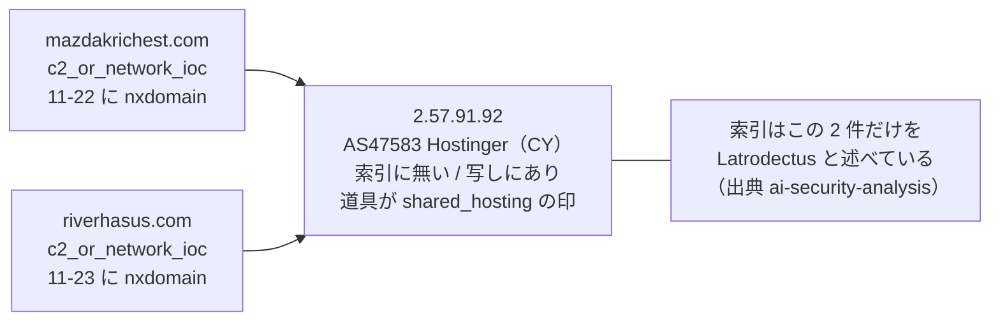
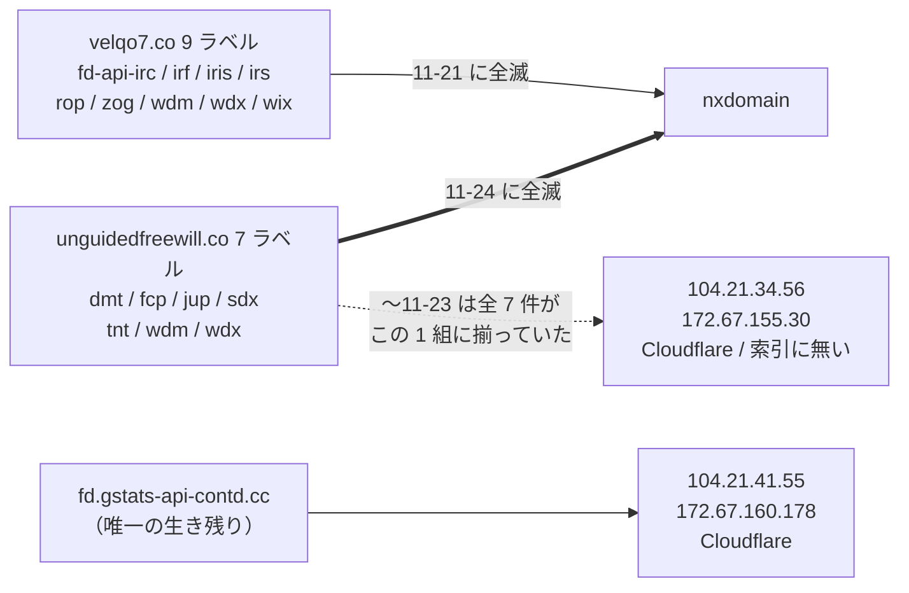
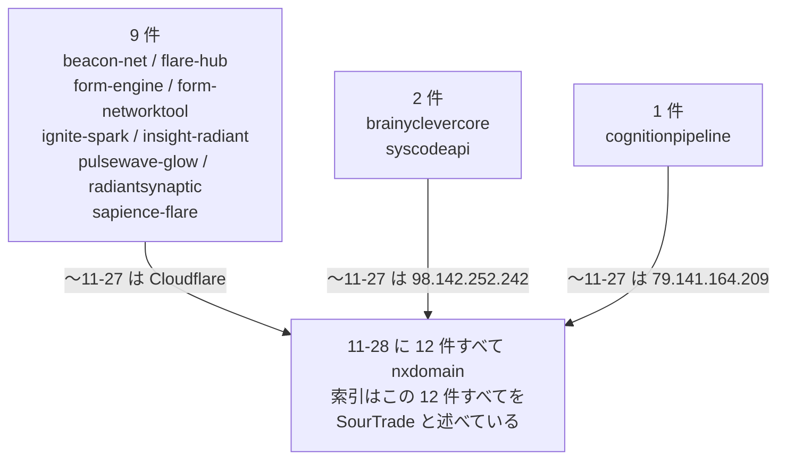
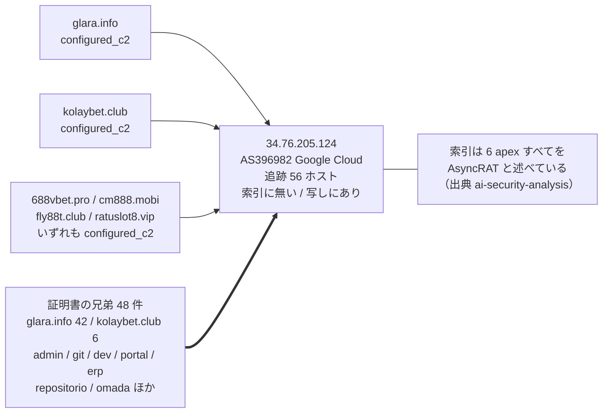
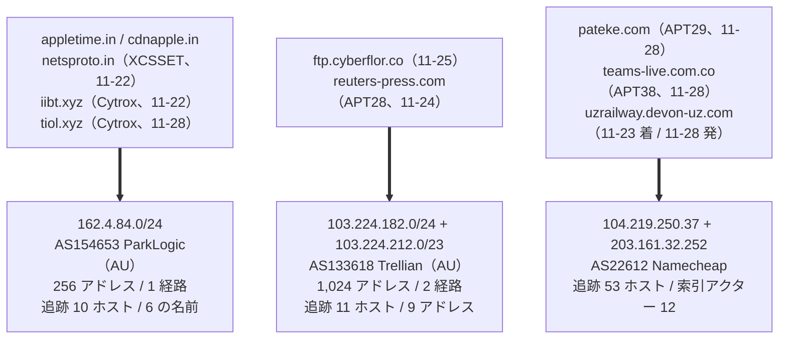
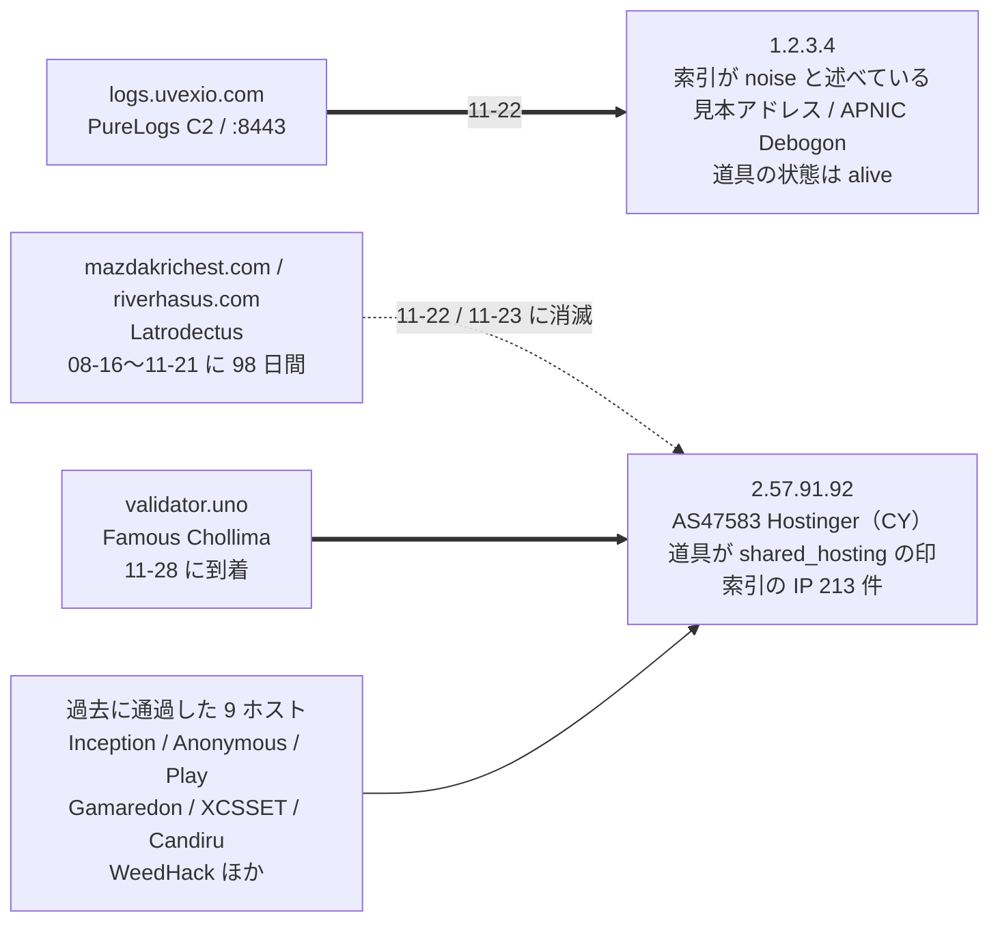
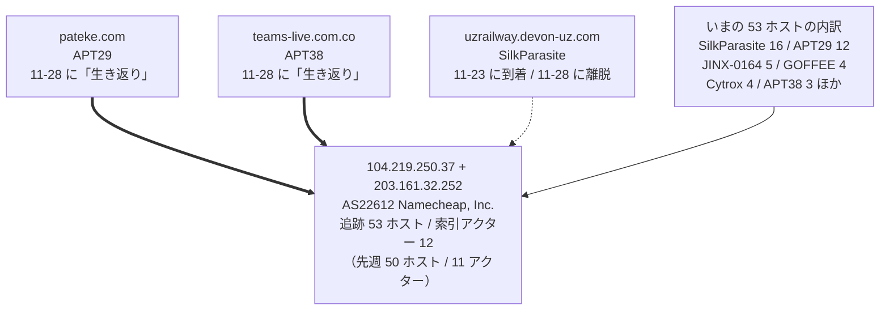

> **このレポートは AI（Claude）が自動生成したものです。人の確認を前提としてください。**

# 週次レポート 2026-W48（2026-11-22 〜 2026-11-28）

## 見つかったもの

### ドメインの生存と切り替わり

**今週のトラッカー（追跡 10,558 ドメイン、観測 7 日: 11-22 〜 11-28 の連続）は変化 400 件。
役割つきの移動は 10 件 / 5 ホストで、そのうち印の無いものは 3 件 / 3 ホスト**
（`zjcounty.com` `ftp.cyberflor.co` `logs.uvexio.com` が各 1 件。残る 7 件は
`gist.github.com` 5 件と `router.bittorrent.com` 2 件で、どちらも `事業者` の印が付く）。
**ただし印の無い 3 件のうち 1 件（`ftp.cyberflor.co`）は行き先がパーキング事業者**なので、
運用の移動として数えられるのは 2 件だけ（「疑い」で潰す）。

- **`logs.uvexio.com`（PureLogs C2、索引は `:8443` の端点も持っている）が 11-22 に
  `64.89.160.210`（AS403005 Blatant Technologies / SC）から `1.2.3.4` へ移った。**
  `1.2.3.4` は**索引自身が `noise: 見本アドレス / APNIC Debogon Project` と
  述べているアドレス**で、確度は `confirmed`。つまりこれは移転ではなく
  **運用者が A レコードを無効値に差し替えた（妥当）** ——
  C2 の口を止めるときの典型的なやり方で、ドメインは手元に残している。
  **道具はこれを `as_change` として記録し、状態は `alive` と出す**（「疑い」に再掲）。
  追跡開始（08-16）からの変化は 3 回で、`193.26.115.118` → `124.198.131.137`（09-15）
  → `64.89.160.210`（10-07）→ `1.2.3.4`（11-22）。
  **`64.89.160.210` は索引にも写しにも無い**（AS403005 に索引の IP は 3 件あるが、
  `64.89.161.16` など別の /24）
- **`zjcounty.com`（`payload_distribution_host`）が 11-28 に
  `177.211.76.79`（AS134175 DingFeng XinHui / HK）から
  `45.207.80.199`（AS142286 LUOGELANG (FRANCE) LIMITED / HK）へ移った。**
  **追跡開始からの変化 6 回のうち 4 回が 11-06 以降に集まっている**
  （`156.250.73.75` → `156.250.75.207`(11-06) → `107.151.224.53`(11-09)
  → `177.211.76.79`(11-11) → `45.207.80.199`(11-28)）。
  **AS134175 も AS142286 も `asns.jsonl` に出てこないので、索引はこの 2 つの AS に
  IP を 1 件も持っていない。** `45.207.80.199` は写し（`derived-iocs.jsonl`）にも無い

**落ちた 77 件。役割つきは 2 件だけだが、その 2 件は同じマルウェアで 1 日差で消えた**
——`mazdakrichest.com`（11-22）と `riverhasus.com`（11-23）、どちらも
`c2_or_network_ioc` で索引は **Latrodectus** と述べている（「つながったもの」に図）。
残る 75 件は役割を述べられていないが、**索引がアクターを与えているものが 48 ホストあり、
今週はその落ち方が一族ごとに揃っている。**

- **`SourTrade` の 12 ホストが 11-28 の 1 日に揃って nxdomain になった**（`.digital` ばかりで
  `beacon-net` `brainyclevercore` `cognitionpipeline` `flare-hub` `form-engine`
  `form-networktool` `ignite-spark` `insight-radiant` `pulsewave-glow` `radiantsynaptic`
  `sapience-flare` `syscodeapi`）。**前日まで 9 件が Cloudflare の裏に居た**のに
  nxdomain になったので、IP ではなくドメインそのものが消えている（「つながったもの」に図）。
  SourTrade の追跡 98 ドメインは **alive 37 / nxdomain 59** になった
- **`PasteSwitch` の 10 ホストが落ち、うち 7 件が 11-24 の `unguidedfreewill.co` の
  ラベル全部**（`dmt` `fcp` `jup` `sdx` `tnt` `wdm` `wdx`）。
  **これは先週のレポートが「次の apex を当てる鍵」として名前を挙げた apex そのもの**で、
  予想した方向とは逆に、鍵ごと畳まれた（「つながったもの」に図）。
  残る 3 件は `hbomax-macos.com`（11-24）`lalandscapelighting.com`（11-26）
  `chatgpt-safepage.com`（11-27）。追跡 148 ホストは **alive 64 / nxdomain 80**（先週 74 / 70）
- `Ghostwriter` の 5 件は **`com-account.website` とその 4 つの子**
  （`accounts-support.` `facebook.com-` `google.com-` `microsoft.com-`）が 11-23 に同時。
  **他人のドメインを丸ごとラベルに入れる形**で、apex ごと消えた
- `APT38` の 5 件は `ms-live.com`（11-25、nxdomain → parked）`docsend.space`（11-27）
  `02webus.zoom.02us.sbs` `web02eu.live` `webus.zoom.02web.sbs`（11-28）。
  **`zoom` を騙る 2 件が同じ日**だが、**同じ週に `teams-live.com.co` が「生き返って」
  受け皿に落ちている**ので「疑い」に再掲する
- `Inception` の 4 件は `legal-alaskaair.com` `legal-mcdonalds.com` `reddit-legal.com`（11-27）
  `legal-kfc.com`（11-28）。**`legal-` + 実在ブランドという 1 つの型**で 2 日に集まっている
- `BADBOX 3.0` の 4 件は `drgdj.top` と `api.` `file.` `gh.` が 11-26 に揃って。
  `Darkhotel` の 2 件は `console.hangro.net` `info.hangro.net` が 11-27 に揃って
- `Gamaredon` の 4 件のうち 2 件は `srv166997.hoster-test.ru` の**同じホストの往復**
  （11-23 復活 / 11-25 死亡 / 11-26 復活 / 11-28 死亡）。
  **名前が事業者の試験ホストなので所見にしない**

**生き返った 16 件は 1 件も役割を述べられていない。** 索引がアクターを与えているのは
15 ホストだが、**行き先を見ると大半が受け皿への到着**で、運用の再開ではない。
`pateke.com`（APT29）と `teams-live.com.co`（APT38）は 11-28 に
**Namecheap の `104.219.250.37` + `203.161.32.252`**（「疑い」に図）、
`validator.uno`（Famous Chollima）は 11-28 に **`2.57.91.92`** ——
**Latrodectus の 2 件が前日まで居たのと同じアドレス**（「疑い」に図）。

**測定側は先週から変わっていない。** `別名の向き先が変わった` は今週も **0 件**で、
`cname_change` の記録は **2026-10-08 が最後**。**変化が無かったのではなく見えていない
（CNAME と IPv6 の変化は所見にしない）。** 判定保留は **233 / 10,558 件（2.2%）**で
5% の線は超えていない。生存 3,847 件の内訳は CDN 2,268 / 動的 DNS 357 / 事業者 1,039。

### 証明書の記録から出た兄弟

**新しい兄弟は 0 / 223 件。** `crtname.jsonl` は先週と 1 行も違わない。
取得は先週と同じく **100 / 141 apex で打ち切られた（HTTP 429、1 件は取得失敗）**。
打ち切りは名前順なので `riverhasus.com` 以降の 41 apex は今週も読めていない。
**読めなかったぶんは消失と読まない**（なお、打ち切り点に当たった `riverhasus.com` は
今週 nxdomain になった Latrodectus の C2 で、**兄弟を読む前に消えた**）。

**新しく共用基盤と判定された apex は無い**（先週の 6 と同一）。
`dropboxusercontent.com`（148,334）`42web.io`（46,774）`chickenkiller.com`（42,546）
`netcup.net`（31,976）`4nmn.com`（8,489）`cpolar.top`（605）。
のべ 279,219 ホストを見て事業者既定の名前 193 件を落とし、223 件が残った。

223 件のうち**生きているのは 67 件**（先週 77）で、解決先は **9 個の IP** しかない。

| IP | 兄弟 | AS | 索引 | 先週 |
| --- | --- | --- | --- | --- |
| `34.76.205.124` | 48（`glara.info` 42 / `kolaybet.club` 6） | AS396982 Google Cloud Platform | **無い** | 56 |
| `147.135.84.14` | 8（`asecdns.com`） | AS16276 OVH SAS | **無い** | 8 |
| `192.185.37.239` | 6（`magsa.com.pe`） | AS31898 Oracle Cloud | **無い** | 6 |
| `185.207.224.40` | 2（`elpasohonroso.com`） | AS205035 LucusHost SL | **無い** | 2 |
| `80.237.138.5` | 1（`pameva.com`） | AS34011 Host Europe GmbH | **無い** | 1 |

残り 2 件は Cloudflare の背後（`alpharush.ai` と `geschmeidig6307-kotyatanet.sbs` の
兄弟 1 件ずつが、それぞれ 2 アドレスを返している）。

**先週の表にあった `103.224.93.246`（AS151406 Yeahhost）が消えた。**
`cyberflor.co` の兄弟 2 件（`decohub.com.my.cyberflor.co` と `www.` 付き）が
**11-25 に揃って no_answer になり、同じ日に apex 側の `ftp.cyberflor.co` が
パーキングへ移っている** ——**3 ホストが同じ日に動いたので、ドメインの失効と読むのが自然
（妥当）**。「疑い」で潰す。

**`glara.info` は 1 週間で 7 件を失った**（49 → 42）。
11-23 `openapi`、11-25 `xcx` `www.xcx`、11-26 `backend` `www.backend` `mp` `www.mp`。
`kolaybet.club` は `test.` が 11-25 に落ちて 7 → 6。
**どちらも一括ではなく 1 日 1〜4 件の目減り**で、apex（`glara.info` `kolaybet.club`）は
両方とも生きたまま `34.76.205.124` に残っている。死んでいる側では
`iuqerfsodp9…` の 79 / 79 件・`789betapps.com` の 15 / 15 件・`orangesac.com` の 6 / 6 件が
引き続き nxdomain。

## つながったもの

### Latrodectus の 2 つの C2 が 1 日差で揃って消えた

**今週の役割つきの死亡は 2 件しかなく、その 2 件が同じマルウェア（Latrodectus）で、
同じアドレスに居て、1 日差で消えた。** 追跡開始（08-16）から 11-21 まで
**98 日間ずっと `2.57.91.92` に居て、1 度も動いていない。**
索引はこの 2 件にだけ Latrodectus を与えており、他の名前は付いていない。

**同じ運用者の 2 本の口が一緒に畳まれた、と読むのが素直（妥当）。**
根拠は **索引側の族名が一致していること**と**消えた日が隣り合っていること**の 2 つで、
**同じ IP に居たことは根拠に入れていない** ——`2.57.91.92` は Hostinger の共用で、
**他に 9 アクターのホストが時期をずらして通過している**（「疑い」に図）。
`2.57.91.92` は索引（`iocs.jsonl`）に無く、写しには
`instagam.in` `wizzifi.com` を含む 4 ドメインの `resolves_to` として入っている。

### PasteSwitch は apex を 1 つずつ焼いていて、先週名指しした apex が今週消えた

**先週のレポートは `wdm` / `wdx` / `fd-api-` というラベルの組を鍵にすれば
まだ索引に無い次の apex を先に拾えると書いた。今週その鍵が使えなくなった。**
`unguidedfreewill.co` の 7 ラベル（`wdm` `wdx` を含む）が **11-24 に揃って nxdomain**。
`velqo7.co` の 9 件が 11-21 に揃って消えたのと**同じ形**（前日まで Cloudflare の
1 組に全部が揃っていて、翌日に全部が nxdomain）。

**apex を 1 つずつ使い捨てる運用で、使い捨ての間隔は 3 日（妥当）。**
`fd-`/`wd` 系で生きているのは **`fd.gstats-api-contd.cc` の 1 件だけ**になった。
**「ラベルの組は変えない」という先週の読みは、apex が死ぬ速さには勝てない** ——
鍵として使うなら、索引に入る前の apex を証明書記録などで先に拾う必要がある
（「そこから得られそうなもの」に再掲）。
`104.21.34.56` `172.67.155.30` はどちらも索引に無い。

### SourTrade の 12 ドメインが 1 日で消えた。Cloudflare の裏でも nxdomain になっている

**12 件が 1 日で消え、しかも 9 件は Cloudflare の裏に居た。**
CDN の裏のドメインが nxdomain になるのは **IP ではなく権威側（登録またはネームサーバ）が
消えたとき**なので、これは運用者の引っ越しではなく **ドメインの一括停止（妥当）。**
3 つの異なる解決先に分かれていたものが同じ日に揃うことも、
**解決先ではなく登録の側で起きた処理**であることを支持する。

**ただし停止したのが誰かは言えない（弱い）。** 失効（更新しなかった）と
措置（レジストラ・レジストリによる停止）は、観測している A レコードの側からは区別が付かない。
12 件はすべて **`.digital`** で、**追跡開始（08-16）から 11-27 まで 1 度も動いていない**
（`brainyclevercore` `cognitionpipeline` `syscodeapi` の 3 件だけが 08-18 と 10-08 に
IPv6 を落とす形の変化を 1 回ずつ持つ）。索引はこの 12 件に**役割を述べていない**ので、
**何が止まったのかは分からない。** SourTrade の残りは **alive 37 / 98 件**で、
生きている側は 1 件ずつ別の Cloudflare のアドレスに散っている。

### 証明書の兄弟 48 件が居る 1 つの IP に、AsyncRAT の 6 つの apex が揃っている

**索引は 6 つの別々の apex を `configured_c2` かつ AsyncRAT として持っているのに、
6 件が揃って解決している `34.76.205.124` を持っていない**（写しには
`glara.info` の `resolves_to` として入っている）。
この IP に居る追跡ホストは **56 件で、54 件がこの 6 apex とその証明書の兄弟**。
残る 2 件は `viva.gr.com`（Cytrox）と `zu7pl.pro`（AnonyMousTeam）。
**証明書の兄弟が 48 件も同じ 1 つのアドレスに固まっているので、
6 apex の持ち主は 1 人と読める（妥当）。**

**ただし今週の新しい話ではない。** 6 apex の到着は
`glara.info` 08-21、`688vbet.pro` `kolaybet.club` `ratuslot8.vip` 09-12、
`cm888.mobi` `fly88t.club` 09-16 で、**それ以降 1 度も動いていない。**
**今週この固まりに起きた変化は、兄弟が 8 件目減りしたことだけ**（56 → 48）。
兄弟の名前（`admin` `git` `dev` `portal` `erp` `repositorio` `omada` `staging`）は
**事業者の社内システムの形**なので、先週 `magsa.com.pe` で書いたのと同じ疑いが残る ——
**固まっていることは「同じ持ち主」までしか言わず、その持ち主が攻撃者か被害者かは別の問い。**
索引が役割を述べているのは 6 つの apex だけで、兄弟 48 件には何も述べていない。

**ピボットからは、つながりとして書けるものは今週も出なかった。** 橋は 27 組通ったが
（58 組のうち通過 27・索引で既知の組 7 / 索引に無い組 20・全部落ちた 31）、
**先週に無かった組は 3 組だけ**で、その 3 組は **2 つの値の上にしか乗っておらず、
2 つとも検分で落ちた**（内訳は「疑い」）。**ガードを通ったこと自体は根拠にしない。**
27 組すべての検分は「疑い」に置く。
（写し 300 件 / API 328 回・空振り 131・索引に無い検体 2,151 件・
的 150 = IP 120 / ドメイン 30 から）

## そこから得られそうなもの

- **`34.76.205.124`（AS396982 Google Cloud）を次の手動の的にする（妥当）。**
  **索引（`iocs.jsonl`）に無い**のに、索引が `configured_c2` かつ AsyncRAT として
  持っている **6 つの apex がここに解決している**うえ、**証明書の兄弟 48 件も同じ 1 点。**
  この IP の居住者を引けば、**索引に無い AsyncRAT の apex が出る可能性が高い**
  （今の 56 ホストのうち 2 件は Cytrox と AnonyMousTeam なので、
  **居住者が 6 apex の一族だけかどうかが、持ち主が 1 人かの判定にもなる**）。
  `34.76.205.0/24` にも索引の IP は無い。ただし AS396982 には道具が
  `shared_hosting` の印を付けている（索引の IP 42 件）ので **AS を根拠には使えない**
- **`logs.uvexio.com` に付いた索引外の検体 4 件が、今週いちばん筋の良い入口（妥当）。**
  このドメインは索引が `PureLogs C2` と `:8443` の端点まで述べており、
  **今週 A レコードが `1.2.3.4` に差し替わった**ので、**運用者が畳む直前の検体**が
  拾えていることになる。引けた 5 件（うち 4 件が索引に無い）は
  `Ovspyqciom.exe`（検知 35 / 2026-10-27）`Npsfyld.exe`（50 / 2026-04-28）
  `Iqnfpf.exe`（47 / 2026-10-27）`Exnkkwsak.exe`（38 / 2026-08-21）
  `Lbholi.exe`（55 / 2026-07-29）。**vhash が `2850367515118095` で 2 件、
  `2850367515117095` と `2450367515116095` がそれぞれ 1 件**——
  **上位 11 桁 `28503675151` が 3 件で共通**し、残り 1 件も 1 文字違い。
  **同じビルダーの連番と読んで妥当。** 名前は 1 検体ごとに違う無意味な綴りだが、
  **PureLogs の既定の命名**なので汎用スタブの印ではない。
  ただし**サイズは写しに無く、同一ビルドまでは未確認（弱い）**
- **`zjcounty.com` が渡り歩いている HK の小規模 AS 2 つが、索引の空白地帯（妥当）。**
  `AS134175 DingFeng XinHui` と `AS142286 LUOGELANG (FRANCE) LIMITED` は
  **どちらも `asns.jsonl` に出てこない**ので、**索引はこの 2 つの AS に IP を 1 件も
  持っていない。** `45.207.80.199` は写しにも無い。追跡しているホストも 1 件ずつなので、
  **居住者を数えるには向いている。** 11-06 以降 4 回動いているので**まだ畳んでいない**
- **`ftp.dankely.org` の索引外検体 22 件は、スペイン語の釣りの束（妥当）。**
  先週の 21 件に `Remittance Copy.JS`（検知 21 / 2026-11-19）が 1 件増えた。
  **vhash `541915dcfead7b69` が 3 件で共通**で、`rylrxx7.exe`（検知 39）
  `orden de compra #000790650.xlam`（34）`SOLICITUD DE PRESUPUESTO 08978.xlam`（34）——
  **`.xlam`（Excel アドイン）で見積・発注を騙る形が揃っている。**
  索引はこのドメインを `c2_or_infrastructure_as_recorded` と述べているので、
  **この 22 件から送り先の一覧が取れる見込み**
- **`89.185.82.12`（AS215540）は先週の優先度を維持する（妥当）。** 先週 44 件だった
  XCSSET の固まりは **41 件**になった。減った 3 件（`appletime.in` `cdnapple.in`
  `netsproto.in`）は 11-22 に揃って **ParkLogic（パーキング）へ抜けている**ので、
  **残った 41 件のほうは受け皿ではない**という読みが 1 つ強くなった（「疑い」に図）。
  この IP は索引にも写しにも無い
- **`PasteSwitch` の次の apex を当てるには、索引の外から取らないと間に合わない（弱い）。**
  先週鍵にした `wdm` / `wdx` / `fd-api-` のラベル組は、**乗っていた apex が 3 日で死んだ。**
  生きているのは `fd.gstats-api-contd.cc` の 1 件だけで、
  **`velqo7.co` → `unguidedfreewill.co` の間隔が 3 日**なら、
  **索引に入ってから追うのでは常に遅れる。** 証明書の記録（`fetch-crtname.mjs`）は
  役割つき apex だけを的にしているので、**まだ索引に無い apex はそもそも読みに行っていない**

## 疑い

### 3 つのパーキング事業者が、今週の「移動」10 件をひとりで作っている

**今週の移動 307 件のうち 10 件が、この 3 か所への到着である。**
`ParkLogic` と `Trellian` はどちらもオーストラリアの**ドメイン・パーキング事業者**で、
`162.4.84.0/24` の 10 ホストには **XCSSET・SessionGate・Cytrox・DEV-0861・SilentDelivery・
Windows Script Stager** の 6 つの無関係な名前が、`AS133618` の 11 ホストには
**APT43・APT28・Toy Ghouls・Cytrox・Flax Typhoon・PhantomEnigma・DPRK IT Worker Schemes** の
7 つが混ざる。**互いに無関係な名前が 1 つの事業者の狭い範囲に集まる形なので、
これは運用の移動ではなく失効・パーキングの受け皿（妥当）。**

**この 10 件を所見にしてはいけない。** とくに次の 2 件は印が付かないので危ない。

- **`ftp.cyberflor.co`（`c2_or_infrastructure_as_recorded`、印なし）。**
  11-25 に `103.224.93.246`（Yeahhost）→ `103.224.212.143`（Trellian）。
  **同じ日に証明書の兄弟 2 件が no_answer になっている**ので、
  これは移転ではなく **`cyberflor.co` の失効（妥当）**
- **`appletime.in` `cdnapple.in` `netsproto.in`（XCSSET）。**
  11-22 に `89.185.82.12` から `162.4.84.248` へ。
  **「XCSSET が新しい足場を得た」と読んではいけない** ——抜けた先がパーキングなので、
  **この 3 件は畳まれた側**。残る 41 件は `89.185.82.12` に居たまま

**道具はこの 3 か所をどれもパーキングの一覧に入れていないので、状態は `alive` と出て、
変化は `as_change` として記録される。** さらに **索引側にも入り込んでいる** ——
`AS133618` の中に索引の IP が **30 件**（すべて `103.224.182.x`）、
`AS154653` の中に **1 件**（`162.4.84.247`）ある。**パーキングのアドレスが
IOC として索引に載っているということなので、これは所見ではなく報告事項。**

### `1.2.3.4` と `2.57.91.92` ——「生きている」と出るが中身が違う 2 つ

**どちらも道具は `alive` と報告するが、所見に使える状態ではない。**

`1.2.3.4` は**索引自身が `noise`（見本アドレス / APNIC Debogon Project）と
`confirmed` で述べているアドレス**で、ここへの移動は運用者が口を止めた印。
**「PureLogs が新しい基盤に移った」と読んではいけない。**

`2.57.91.92` のほうは逆で、**Latrodectus の 2 件が同じアドレスに居たことを
根拠に数えてはいけない。** このアドレスには追跡開始から **11 ホストが時期をずらして
通過しており、`Inception` `Anonymous` `Play` `Gamaredon` `XCSSET` `Candiru`
`WeedHack` `Famous Chollima` と無関係な名前が並ぶ。** AS47583 Hostinger は
**2,367,488 アドレス**を持ち、道具は `shared_hosting` の印を付けている（索引の IP 213 件）。
**11-28 に `validator.uno`（Famous Chollima）が「生き返り」としてここへ到着した**のも、
Latrodectus が抜けた枠に別の借り手が入っただけと読むのが自然（妥当）。
**「つながったもの」に書いた Latrodectus の組は、族名の一致と日付の近さだけで組んでいる。**

### Namecheap の受け皿は今週も増え、APT29 と APT38 の「生き返り」を受けた

先週 50 ホスト / 11 アクターだったものが **53 ホスト / 12 アクター**になった。
**無関係な 12 アクターが 1 組のアドレスに混ざる形は先週と同じ**なので、
**受け皿と読むほうが自然（妥当）。所見にしない。**

**今週の `pateke.com`（APT29）と `teams-live.com.co`（APT38）は、
どちらも「生き返った」として記録されているが、着いた先がここ。**
`teams-live.com.co` については、**同じ `teams-live.*` 一族が
先週 3 件ここへ落ち、今週も APT38 の 5 件が落ちている**ことと矛盾しない。
**「APT29 と APT38 が戻ってきた」と読んではいけない。**
`uzrailway.devon-uz.com`（SilkParasite）は 11-23 にここへ来て 11-28 に
`45.86.162.115`（AS199959 GWY IT PTY LTD）へ抜けており、**出入りの両方が記録されている。**
`104.219.250.37` も `203.161.32.252` も、道具のパーキング受け皿の一覧に
入っていないため状態は `alive` と出る。

### 橋 27 組の検分（**どれも所見にできない**）

写しから検体の型・サイズ・名前を引き直した。
**先週に無かった組は 3 組で、2 つの値の上にしか乗っておらず、2 つとも落ちた。**

| 組 | 値 | 索引側＋拾った側のサイズの幅 | 判断 |
| --- | --- | --- | --- |
| **JADEPUFFER ↔ Sandworm Team / Sandworm Team ↔ Storm-3168（どちらも新規）** | vhash `7bb8336e…` | 2 検体・70,736 〜 82,688 B（1.2 倍） | **却下**（索引側 1 件の族名が `ddos` `mirai`、名前が `paraiso.x86`。拾った 1 件は 82,688 B の ELF で名前が `awoo`（検知 40・**初観測 2026-11-27**）。**どちらも Mirai の派生ビルド**で、Mirai のソースは公開されており数百の無関係な運用者が同じ木から作る。**Sandworm Team を JADEPUFFER / Storm-3168 に結ぶ根拠にはならない。** 経由した `45.131.66.106` は索引が JADEPUFFER / Storm-3168 の C2 として持つ IP なので、**そこに Mirai の子が 1 匹居ただけ**） |
| **Volant Manticore ↔ shinyenigma（新規・根拠 4）** | vhash `09ff81c2…` | 2 検体・2,204,537 〜 3,090,925 B（1.4 倍） | **却下**（**両方が ZIP 書庫**。索引側 `hnrhw9.zip`（検知 14・族名 `muddywater` `kuboshell`）、拾った側 `DownloaderPack.zip`（検知 52）。**vhash が ZIP に対して見るのは書庫の構造で、中身のコードではない。** しかも `known_pair=true` ——**索引が既に結んでいる組**なので補強にもならない） |
| Myxa VPN ↔ masterblack / Storm-3358 ↔ masterblack / Gambling Goblin ↔ Myxa VPN / Gambling Goblin ↔ Storm-3358 / Myxa VPN ↔ OceanGate / OceanGate ↔ Storm-3358（**計 6 組**） | vhash `e840a106…` | 5 検体・5,750,968 〜 16,203,960 B（**2.8 倍**） | **却下維持**（先週と同じ値。索引側の族名が `adaptixc2`（公開 C2 フレームワーク）`agnt` / `multiverze`、`frpc`（**実在の OSS リバースプロキシ FRP**）。**今週はこの 1 値だけで 27 組のうち 6 組（22%）を作っている**） |
| Golden Chickens ↔ KongTuke / KongTuke ↔ Qilin / KongTuke ↔ TAG-195 | vhash `c0898bab…` | 3 検体・49,152 〜 1,298,432 B（**26.4 倍**） | **却下維持**（拾った 2 件はどちらも 49,152 B の Windows Installer で**同じ日（2026-03-18）**。索引側は 1,298,432 B の `update.msi`） |
| Flax Typhoon ↔ Storm-3358 / Inception ↔ Storm-3358 / CameraSwarm ↔ Storm-3358 | imphash `6ed4f5f0…` | 4 検体・1,718,272 〜 7,266,304 B（4.2 倍） | **却下維持**（索引側 3 件の族名が `fscan` `revsocks` `salat`。**公開の攻撃・運用ツール**で、Go で固めた実行体が同じ取り込み表を持つのは当然） |
| Storm-3358 ↔ Toy Ghouls（根拠 5）/ Myxa VPN ↔ Toy Ghouls | imphash `70d2e884…` | 4 検体・11,656,964 〜 148,437,699 B（**12.7 倍**） | **却下維持**（索引側が `localtonet.dll` / `localtonet.exe`——**実在のトンネリング事業者 LocalToNet のクライアント**。拾った 3 件も `svc.dll` 15.0 MB・`WindowsUpdateAssistant.dll` 11.7 MB・`ITH-VPN-Proxi.dll` 44.4 MB（検知 2）で、**実在の VPN インストーラが混ざる**） |
| GTG-50014 ↔ Transparent Tribe（根拠 4）/ GOFFEE ↔ GTG-50014 | vhash `0260b666…` | 4 検体・2,186,120 〜 2,337,545 B（1.1 倍） | **弱い維持**。拾った 2 件（`u2n9l9.exe` 2,186,120 B / `gkpkyld.exe` 2,186,128 B。**8 バイト差で検知 25・vhash と imphash の両方を共有**）は同じビルドで妥当。だが**索引側 2 件の名前が `JitsiMeet-Setup.exe` と `Adobe_Acrobat_Reader_Plugin_ru.exe`、族名は `reverseshell` と `havoc` と散っており、この vhash はアクターを指していない。** どちらも `known_pair` なので補強にもならない |
| Chatty Spider ↔ X3D MINER（根拠 5）/ Chatty Spider ↔ The Gentlemen | imphash `1aae8bf5…` | 3 検体・1,762,432 〜 3,885,056 B（2.2 倍） | **弱い維持**。索引側が **`lummastealer`（1.76 MB）**と **`gentlemen` / `blackbyte`（3.89 MB、ランサム）**に割れており、**サイズの帯も重ならない。** 共通の梱包器を指している可能性が高く、情報窃取とランサムが同じ取り込み表を持つことは同一運用を意味しない |
| APT37 ↔ Chatty Spider / APT37 ↔ Myxa VPN | imphash `948cc502…` | 3 検体・915,968 〜 1,212,416 B（1.3 倍） | **却下維持**（索引側の族名が `autoit` で、**AutoIt で固めた実行体の既定の取り込み表**。拾った 1 件の名前が `2025-06-13_…_agent-tesla_amadey_black-basta_cobalt-strike_darkgate_elex_luca-stealer`——**7 つの無関係な族名が 1 つのファイル名に並ぶ寄せ集めの配布物**） |
| SMOKE#SCREEN ↔ Storm-2949（根拠 16） | vhash `056056655d…` | 2 検体・5,689,656 〜 5,873,112 B（1.0 倍） | **却下維持**（サイズは揃っているが族名が `connectwisecontrol` / `sconnect`、拾った検体は `ScreenConnect.ClientSetup.exe`。**実在の RMM**） |
| Exvicy ↔ UAT-6275 | vhash `4ff2a788…` | 6 検体・260 〜 1,632 B（**6.3 倍**） | **却下維持**（**数百 B の PowerShell では vhash が形しか見ない**。拾った 5 件の検知は 0 〜 5 で、名前は `update.ps1` と `sleestak_payload_1.ps1` の 2 種が繰り返すだけ） |
| FortiBleed ↔ UNK_DeadDrop | vhash `77ac44bd…` | 2 検体・6,881,442 〜 14,655,650 B（2.1 倍） | **判断保留維持**（2 件しか無く、ELF の族名も `overlord` と拾った側の無名で割れている。索引側の名前が `google-update-support-linux-amd64` なので**騙りの形は揃っている**が、先週から材料が増えていない） |
| Storm-2949 ↔ The Gentlemen | imphash `c2d457ad…` | 2 検体・1,947,136 〜 6,555,648 B（**3.4 倍**） | **却下維持**（拾った検体は `tor-relay-scanner-go-windows-amd64.exe`。実在の OSS） |

**`Storm-3358` は 27 組のうち 7 組に出ており、その 7 組すべてが
先週すでに却下した値の上に乗っている**（`e840a106…` 3 組・`6ed4f5f0…` 3 組・
`70d2e884…` 1 組）。**今週初めて橋を作った 2 つの値は、どちらも
「道具ではなく公開のソース」のほうだった** ——Mirai のビルドと ZIP 書庫の構造。
**索引に新しいアクターが入ると、公開ツールの取り込み表だけでなく
公開マルウェアのソース木や書庫の形まで橋を増やす**ということで、
**ガードは「落とすべきものを落とす」側は効いているが（58 組のうち 31 組を落とした）、
公開の素材から来る一致は通してしまう。**
なお先週通っていた `GTG-50014 ↔ PhantomEnigma` と `GTG-50014 ↔ Rognar`
（imphash `88016fcd…`、先週も却下）は今週は出ていない。

### 毎日組

**毎日組は 34 件**（観測 7 日のうち 4 日以上動いたもの、追跡 10,558 件中。先週 36 件）。
実測どおり `business-data-leaks.com` の一族 6 件（`app.` `demo.` `help.` `id.` `member.`
`wifi.` と apex）と `ep6pheij.com` の一族 4 件（`app.` `assets.` `portal.` と apex）が
7 / 7 日動いている。今週は **`daum.net` / `kakao.com` の一族 10 件**（`logins.daum.net` `mail.daum.net`
`member.daum.net` `policy.daum.net` `m1.daumcdn.net` `m2.daumcdn.net` `spi.maps.daum.net`
`track.tiara.daum.net` `stat.tiara.kakao.com` `track.tiara.kakao.com`、いずれも 4 〜 6 / 7 日）
も入っている。**韓国の大手ポータルの正規ホストなので所見にしない。**
**役割つきは `gist.github.com`（`dead_drop_configuration`、5 / 7 日、`毎日組` `事業者` の印）
だけ**で、今週の役割つきの移動 10 件のうち 5 件がこれ。
`140.82.112.0/24` `140.82.113.0/24` `140.82.114.0/24` の 3 つの /24 を
行き来しているだけなので、**所見にしない。**
